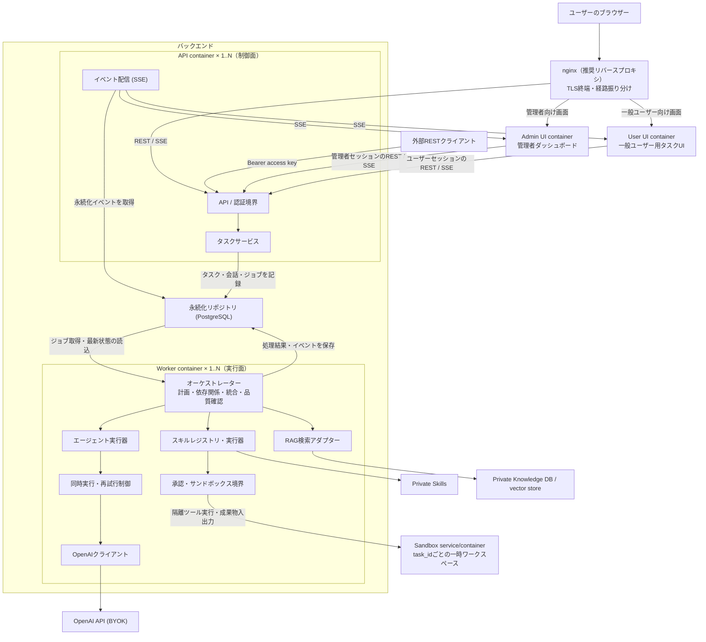
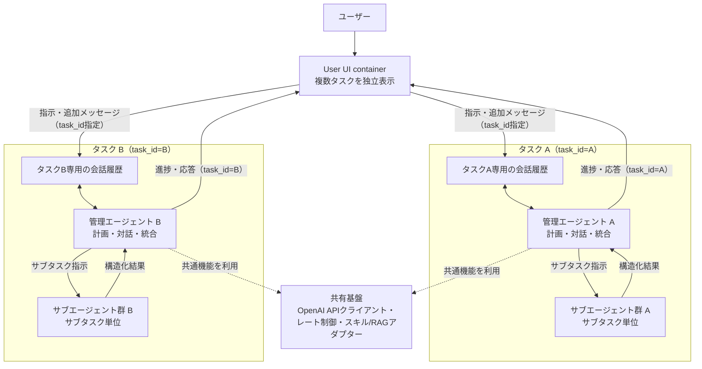
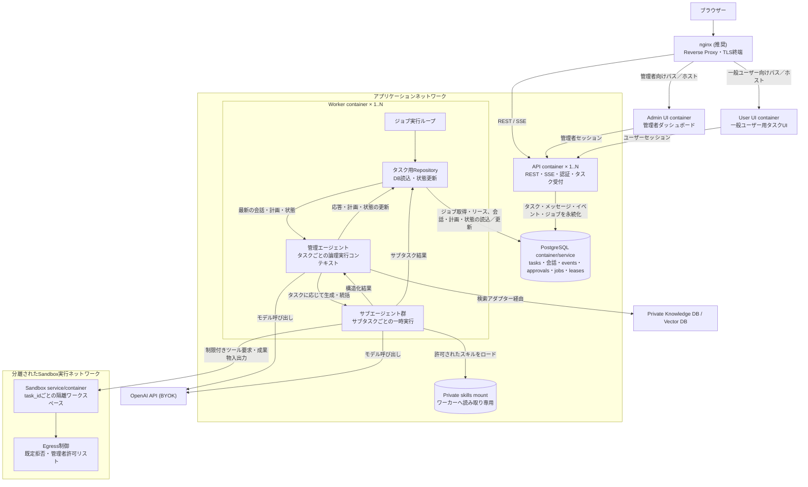
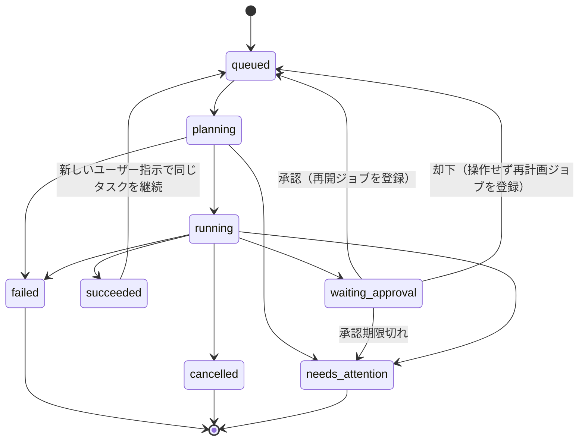
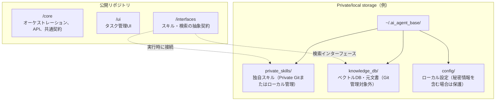

# マルチタスク型AIエージェント基盤 設計書

## 1. 目的と設計方針

本書は [`00_requirements.md`](./00_requirements.md) に定めるマルチタスク型AIエージェント基盤の構成と動作を定義する。ユーザーの複数の指示を独立したタスクとして受け付け、管理エージェントが計画・分割し、必要なサブエージェントを並行実行して結果を統合する。

設計上の基本方針は以下のとおり。

1. **コアと独自資産を分離する**: 公開コアには汎用制御と抽象インターフェースのみを置き、独自スキル・ナレッジ・元文書は非公開領域に置く。
2. **外部APIと副作用を制御する**: OpenAI API呼び出しは共通クライアントに集約し、レート制御・リトライ・監査を行う。ファイル変更や外部API実行は承認とサンドボックスを経由させる。
3. **中断から復旧できる**: タスク、サブタスク、イベント、承認状態を永続ストアへ逐次保存する。再起動時に安全に再開できない処理は自動再実行せず、状態を明示してユーザー判断を求める。
4. **モデルや外部実装に依存しない**: モデルID、スキル、検索基盤、実行バックエンドは設定またはインターフェースを通じて切り替える。

## 2. スコープと前提

### 2.1 対象範囲

- タスク管理UIおよびバックエンドAPI
- 管理エージェントによる計画、サブエージェント統括、成果物の統合
- OpenAI APIを利用するBYOK認証
- スキルの動的ロードとRAG検索インターフェース
- 承認フロー、サンドボックス実行、永続化、再開処理
- リアルタイムイベント配信

### 2.2 前提・制約

- 開発・テスト・本番のすべてでPostgreSQLを使用し、SQLiteには対応しない。PostgreSQLはアプリケーション状態の唯一の正規ストアとする。APIとワーカーを分離し、コンテナ数を増やしてもタスク状態とジョブ状態が一貫する構成を基本とする。
- バックエンドはPython（非同期実行、プライベートPythonスキルのロードとの親和性）、HTTP APIはFastAPIを採用する。フロントエンドはTypeScriptベースとし、管理者ダッシュボードと一般ユーザー用タスクUIを別々のコンテナとして配信する。
- モデル名は設定値とする。GPT-6系の名称は要求上の例であり、利用可能な実モデルID・API機能を実行環境で確認して設定する。特定のモデル名や機能をコードに固定しない。
- 知識検索用Vector DBはアプリケーション状態DBとは別の依存コンポーネントとし、特定製品に固定しない。初期構成では検索インターフェースを提供し、利用者の設定に基づいてローカルまたは外部の実装を接続する。
- ネットワークから切断中に新たなモデル応答を生成することはできない。実行中状態を永続化し、接続回復後またはユーザー操作後に再開する。

## 3. システム構成



### 3.1 コンポーネント責務

| コンポーネント | 責務 |
|---|---|
| Admin UI container | 管理者専用の画面を配信。ユーザー管理など管理者権限を要する操作を提供 |
| User UI container | 一般ユーザー専用の画面を配信。ログインユーザー自身のタスク・アカウント操作を提供 |
| API層 | 入力検証、セッション／アクセスキー認証、タスク・会話・承認操作、SSE接続を提供。ユーザー所有権を検証し、モデルAPIキーやプライベートファイルをクライアントに返さない |
| タスクサービス | 永続DBを介したタスク受付・状態変更・ジョブ登録を行う。エージェント実行はWorkerへ委譲する |
| オーケストレーター | Worker内でDBから取得した最新状態に基づき、意図解釈、計画生成、依存関係に沿った実行、結果の検証・統合を行う |
| エージェント実行器 | 管理エージェント／サブエージェントのプロンプトとコンテキストを構築し、モデル呼び出しを行う |
| OpenAIクライアント | BYOKキーの適用、タイムアウト、PostgreSQL上の共有枠と連携したレート制御、429等の再試行、使用量・エラー計測 |
| スキルレジストリ | 設定されたプライベートディレクトリから許可済みスキルをロードし、JSON Schemaと実装を登録 |
| スキル実行器 | 引数検証、危険度判定、承認、専用Sandboxサービスでの実行、実行結果の記録 |
| RAGアダプター | ナレッジ検索の共通インターフェースを提供。文書・ベクトルデータはコアDBに複製しない |
| 永続化リポジトリ | PostgreSQLをコンテナ構成の正本とし、タスク、会話、サブタスク、イベント、承認、ジョブ、リース、要約などを保存。Workerのプロセスメモリーを状態の正本にしない |
| SSE配信 | PostgreSQLに保存済みのイベントを取得して順序付きでクライアントに配信し、Last-Event-IDによる再接続を支援 |

## 4. エージェント構成と通信

### 4.1 エージェント構成

Web UIから送信されるタスクごとに、独立した会話スレッドとオーケストレーション状態を持たせる。タスクはそれぞれ一意な`task_id`で管理し、専用の会話履歴、計画、サブタスク群、成果物、承認状態を紐付ける。管理エージェントの論理実行コンテキストはWorker内でタスク単位に分離し、別タスクの履歴や中間状態を参照・更新しない。再起動やWorker間の引継ぎ後も状態を復元できるよう、WorkerメモリーではなくPostgreSQLを正本とする。

各タスクの管理エージェントは、そのタスクの唯一の調整役としてユーザーとの継続的な対話を担う。ユーザーの追加指示は対象`task_id`に結び付けて会話履歴へ追記し、次の判断・実行へ反映する。処理中に追加指示を受けた場合、実行中のモデル呼び出しやサブエージェント処理を強制中断せず、完了した処理結果を先にDBへ保存する。その後、管理エージェントは次の判断チェックポイントでPostgreSQLから最新の会話履歴・状態を再取得し、追加指示を含めて計画を再評価する。指示が別タスクに混入したり、実行中の計画を暗黙に書き換えたりしない。

管理エージェントはタスク内で必要なサブタスクを生成し、完了結果を受け取ってユーザー向け応答を作成する。サブエージェントはサブタスクの処理単位であり、ユーザーとの独立した会話主体ではない。各サブエージェントには割り当てられたタスク・サブタスクに必要な情報だけを渡し、その応答は対応する管理エージェントへ返す。異なるタスク間で会話履歴やエージェントの作業コンテキストを共有しない。モデルAPIのレート制御やスキルレジストリ等の基盤サービスは共有できるが、タスク固有の状態は共有しない。



会話履歴はタスク作成時から永続化し、UI再接続後も同じタスクの文脈で対話を継続できるようにする。モデルへ送るコンテキストは履歴全件ではなく、タスク固有の会話履歴、現在の計画、関連するサブタスク結果、必要な要約から構成する。長期タスクの要約・プルーニングはモデル入力に限って適用し、正本となるユーザー／管理エージェント間のメッセージ履歴は削除しない。タスク間の履歴参照は、明示的なユーザー操作とアクセス制御を別途設計しない限り許可しない。

### 4.2 管理エージェント

管理エージェントは高性能モデルを用いる。モデル名、temperature等の対応パラメーター、タイムアウトは設定可能とする。責務は次のとおり。

1. ユーザー指示と会話コンテキストから目的・制約・完了条件を抽出する。
2. 必要に応じて、依存関係を持つサブタスク計画を構造化出力で生成する。
3. 各サブタスクに必要な最小限のコンテキスト、スキル、実行パラメーターを割り当てる。
4. 依存関係を満たしたサブタスクを並行実行し、結果と失敗を収集する。
5. 成果物を統合し、完了条件と出典・実行結果に照らして検証する。不足があれば対象サブタスクを再実行するか、部分完了としてユーザーに示す。

計画出力はJSON Schemaで検証する。計画の検証に失敗した場合は、エラーをモデルに返して修正を依頼する。無効な計画を暗黙に実行可能な値へ置き換えない。

### 4.3 サブエージェント

- サブエージェントはサブタスク単位の独立コンテキストとして実行する。非同期ジョブとして管理し、プロセス再起動をまたぐ状態は永続ストアに記録する。
- サブタスクごとに適切な軽量モデルを選択する。モデルIDは設定で上書きできる。
- 各サブエージェントへ渡すスキルは原則1〜2個とし、許可リストに基づいて選ぶ。利用可能スキル全件を自動的にプロンプトへ渡さない。
- サブエージェントの出力は、状態、結果、使用したスキル、エラーを含む固定JSON Schemaで返す。自然文のみの出力はスキーマ検証に通るまで成果物として扱わない。
- 同時実行数は設定上限を設け、OpenAI APIの共有レート制限に対してバックエンド全体でスロットリングする。

### 4.4 Tool Callingと構造化データ

モデルに公開するツールはOpenAI APIの`tools`形式とJSON Schemaで定義する。実行時にはモデル出力を再検証し、未知のツール名、余剰または不正な引数、許可されていないスキルを拒否する。

サブエージェント結果の共通形式:

```json
{
  "status": "succeeded",
  "summary": "サブタスクの要約",
  "artifacts": [],
  "tool_calls": [],
  "error": null
}
```

`status`は`succeeded`、`failed`、`blocked`のいずれかとする。`artifacts`および`tool_calls`は型定義された配列とし、失敗時は`error`に機械可読コードとユーザー向けメッセージを含める。実際のAPIで選択モデルがStructured Outputsに対応しない場合は、通常のJSON応答を受けてサーバー側で同一スキーマ検証を行う。検証失敗を成功扱いしない。

## 5. Dockerコンテナ構成

### 5.1 採用方針

コンテナ運用では、**API（制御面）と非同期ワーカー（実行面）を分離**する。最小構成でもAPIコンテナとワーカーコンテナは別にし、初期のワーカー数は1とする。複数タスク・サブエージェントの同時実行需要に応じて、ワーカーを同一イメージから複数起動して水平拡張する。

アプリケーション全体を単一コンテナにまとめる方式は、ローカルの試作やデモには簡便だが、本番の標準構成には採用しない。APIの応答処理と、モデル待ち・ツール実行など時間の長い処理が同一プロセス／コンテナの資源を競合するためである。また、ワーカー障害や再起動がAPI・SSE接続まで巻き込み、負荷に応じた独立スケールや実行権限の分離が難しくなる。APIとワーカーを分けることで、APIは軽量な受付・認証・イベント配信を維持し、ワーカーはジョブの同時実行数とCPU・メモリ制限を独立して調整できる。ワーカーが停止しても未完了ジョブはDB上に残り、復旧後にリース期限切れジョブを回収できる。

PostgreSQLを開発・テスト・本番で共通の正規永続ストアとして使用する。タスク状態・会話・イベントとジョブ登録はDBトランザクションで確定し、PostgreSQLのジョブテーブルを耐久キューとして利用する。別ブローカーを初期構成に持ち込まないことで、DBとキューの二重書き込みによる不整合と運用要素を減らす。ジョブ取得はトランザクション内のロック／リースで行い、クラッシュ後はリース切れを再取得可能にする。副作用を伴う処理は少なくとも一度の配送を前提とし、冪等性キーまたは実行記録で重複実行を防止する。

### 5.2 コンテナ構成図

管理者ダッシュボードと一般ユーザー用タスクUIは、異なる配信単位・アクセス面として独立したコンテナに分離する。両UIは共通のAPIコンテナを利用するが、管理者向け資産を一般ユーザー用UIの配信物に含めず、nginxから別々の経路にルーティングする。これにより、管理者画面の公開範囲・更新・障害影響を一般ユーザー画面から分離できる。

リバースプロキシにはnginxを推奨する。初期デプロイは単一ホスト上のコンテナ構成であり、Kubernetes固有のIngressリソースを必要としないためである。nginxはTLS終端とUI/APIへの経路振り分けを担い、SSE向けにプロキシバッファリングを無効化し、長時間接続を許容するタイムアウトを設定する。実行環境の標準基盤などに別のリバースプロキシ要件がある場合は差し替え可能とする。



### 5.3 コンテナ責務と運用

| コンテナ／サービス | 責務 | スケール・永続化 |
|---|---|---|
| nginx（推奨） | TLS終端、外部からの入口、管理者UI・一般ユーザーUI・APIへのルーティング | リバースプロキシ用コンテナとして配置する。UIごとの経路を分離し、SSEではバッファリングを無効化して長時間接続を許可する |
| Admin UI | 管理者ダッシュボードの静的資産を配信 | 独立したステートレスコンテナ。一般ユーザー用UIの資産と混在させず、秘密情報を含めない |
| User UI | 一般ユーザー用タスクUIの静的資産を配信 | 独立したステートレスコンテナ。管理者専用画面・権限情報を含めない |
| API | REST、SSE、認証、入力検証、会話・承認操作、DBへの受付記録 | ステートレスにし、必要に応じて複数レプリカ化 |
| Worker | DBジョブの取得・期限切れリースの回収、タスクごとの管理エージェント処理、サブエージェント実行、統合 | 初期1レプリカ。複数レプリカ時はDB上の期限付きスロット／リースで共有の同時実行・APIレート制御に従う |
| PostgreSQL | タスク、会話履歴、イベント、承認、実行状態、耐久ジョブキューの保存 | 永続ボリューム、バックアップ、マイグレーションを適用。アプリ用資格情報は必要権限に限定 |
| Sandbox service/container | シェル／ファイル操作等をWorkerから隔離して実行 | タスク単位の作業領域をツール呼び出し間で維持し、タスク終了時に破棄。API・Workerと権限を分離 |

スキルは信頼済みのプライベート配布元からワーカーへ読み取り専用で提供し、コンテナイメージへ独自ノウハウを焼き込まない。ナレッジDBはプライベートストレージに残し、アダプター経由でアクセスする。PostgreSQLのデータディレクトリだけを永続ボリュームに置き、コンテナのファイルシステムを状態保存先として使わない。APIとワーカーには必要な環境変数のみを注入し、OpenAI APIキーはモデル呼び出しを行うWorkerのみに渡す。キーをイメージ、Composeファイル、ログ、DBへ格納しない。

ワーカーからDockerデーモンのソケットを直接マウントする構成は、ホスト権限の実質的な付与となるため採用しない。専用Sandboxサービス／コンテナで`task_id`ごとの隔離ワークスペースを作成し、同一タスク内のツール呼び出し間ではワークスペースを維持する。Sandboxサービスは`task_id`をキーにワークスペースを識別するため、ツール呼び出しを別Workerが引き継いでも同じ作業領域を利用できる。ユーザーが指定したホストパスやホスト資格情報はマウントしない。成果物はSandboxから検証済みの明示的な出力経路を通じて取得し、タスク終了時にワークスペースを破棄する。Sandboxからの外向きネットワーク通信は既定で禁止し、管理者設定の宛先許可リストに一致する通信のみ許可する。ユーザー指示やモデル出力だけでは許可リストを変更できない。Sandboxサービスが構成されていない環境では、危険な操作をホスト上で代替実行せず、該当ツールを利用不可として報告する。

APIはDBへの書き込み後にのみタスク受付成功を返す。Workerはジョブを短いリース付きで取得し、定期的にリースを更新する。正常終了時は同一トランザクションでジョブ完了・タスク状態・イベントを確定する。Workerの強制終了時はリース失効後に再取得するが、モデル呼び出しや外部副作用が実行済みか判定できない処理は自動再実行せず、`needs_attention`へ遷移させる。

### 5.4 Workerとエージェントの状態管理

管理エージェントとサブエージェントは独立したコンテナではなく、Workerコンテナ内で起動・破棄される論理的な実行単位とする。管理エージェントはタスクごとに一つの調整コンテキストを持ち、そのタスクの会話を処理し、必要なサブエージェントを生成・統括する。サブエージェントは割り当てられたサブタスクの範囲で動作し、会話履歴全体ではなく実行に必要な情報と依存タスクの成果だけを受け取る。サブエージェントの結果は管理エージェントへ返され、Workerが永続化する。

**PostgreSQLをタスク状態・会話履歴の唯一の正本とし、Worker間で会話履歴キャッシュを共有・永続化しない。** Workerはジョブ取得時に`task_id`を使って対象タスク、未処理の会話メッセージ、現在の計画、サブタスク状態、関連する要約・成果物をDBから読み込む。長時間実行中もユーザーの追加指示や別プロセスによる状態変更を反映するため、管理エージェントの各判断チェックポイント（モデルへの次の依頼、計画更新、サブタスク起動、ユーザー応答の確定）でDBを再確認する。モデルへ送る会話コンテキストは、最新の永続化済み履歴とタスク状態からその都度組み立てる。履歴が大きい場合は保存済み要約と必要な直近メッセージを取得し、全履歴を毎回無制限に読み込まない。

モデル応答やサブエージェント出力を得た後は、会話メッセージ、計画・サブタスクの変更、成果物参照、イベント、ジョブ進捗をDBトランザクションで保存してから処理を次へ進める。モデルのストリーミング中間トークンを履歴の確定データとして扱わず、UI向けに配信する場合も完了したメッセージや進捗イベントを正本の更新と区別する。Workerが停止した場合、コンテナ内メモリにしかない会話・計画状態は破棄され、次のWorkerがDBから必要な状態を読み直して再開する。

各タスクの管理エージェント処理は同時に一つだけ実行する。ジョブリースに加えてPostgreSQL上で`task_id`単位の実行リースを取得し、リース保持者のみが会話ターンや計画を確定できるようにする。リース取得・更新には期限と所有者を記録し、期限切れやWorker停止後は別Workerが引き継ぐ。メッセージ追加が長時間処理と競合した場合は、追加メッセージを先にDBへ確定し、実行中Workerが次のチェックポイントで読み込む。リースを失ったWorkerは新たなツール実行を開始せず、実行中のサブエージェントとツール呼び出しへキャンセルを伝播し、状態を書き戻さない。外部副作用を取り消せない場合は実行結果を不確定として記録し、自動再実行を避ける。これにより、DBの状態をWorker内の古いメモリーで上書きしたり、複数Workerが同じタスクの管理ターンを並列に進めたりすることを防ぐ。

この方式ではモデル呼び出し前後や判断チェックポイントごとにDBアクセスが発生するが、Worker再起動後の復旧、Worker間の状態一貫性、タスク別会話の分離を単純なルールで実現できる。会話全体をWorkerメモリーへ長期キャッシュする最適化は初期設計では行わない。将来読み取りキャッシュが必要になった場合も、キャッシュは破棄可能な性能最適化に限定し、更新順序・無効化・排他の正本として利用しない。

コンテナは非rootユーザーで実行し、読み取り専用ルートファイルシステム、明示的なCPU・メモリ上限、ヘルスチェック、graceful shutdownを設定する。Worker終了時は新しいジョブの取得を止め、実行中ジョブの状態・リースを安全に解放または期限切れにする。Compose等の単一ホスト構成は初期デプロイに適するが、高可用性や複数ホストへの拡張時にはPostgreSQLをマネージドサービス等へ移し、ジョブのリース・排他制御が全ワーカーで共有されることを維持する。

## 6. タスク実行・状態管理

### 6.1 状態遷移

タスク状態:



- `queued`: 受付済み、実行待ち
- `planning`: 管理エージェントが計画中
- `running`: サブタスクまたは統合処理を実行中
- `waiting_approval`: 副作用のある操作に対するユーザー承認待ち
- `succeeded`: 完了条件を満たして正常終了
- `failed`: 回復可能な手段が尽きて異常終了
- `cancelled`: ユーザーがキャンセル
- `needs_attention`: 再起動時に安全な自動再開ができない等、ユーザー判断が必要

各状態遷移はDBトランザクションで更新し、同じトランザクション内でイベントを記録する。無効な遷移は拒否する。サブタスクは`pending`、`ready`、`running`、`waiting_approval`、`succeeded`、`failed`、`blocked`、`cancelled`の状態を持つ。依存先がすべて成功した場合のみ`ready`にする。

タスクは実行状態が`succeeded`になった後も会話スレッドとして保持する。完了済みタスクに新しいユーザーメッセージが届くと、同じ`task_id`と履歴を引き継いで`queued`へ戻し、新しい実行サイクルを開始する。実行中または承認待ちに届いたメッセージは履歴に保存して受信確認する。実行中の場合は現在のモデル呼び出しやサブエージェント処理を完了・保存してから、次の判断チェックポイントでWorkerがPostgreSQLから新指示を含む最新情報を取得し、管理エージェントが再計画する。承認待ちの場合はメッセージを保存するだけで承認要求・承認状態を変更せず、承認または却下後の再開Workerが新指示も含めて再計画する。1タスク内でユーザー指示を処理する管理エージェントのターンは直列化し、複数のサブエージェントのみを計画に従って並行実行する。

### 6.2 実行シーケンス

1. UIが指示をREST APIへ送信する。APIは入力を検証し、`queued`タスク、初期会話メッセージ、イベント、耐久ジョブを同一DBトランザクションで保存してからタスクIDを返す。
2. WorkerがDBからジョブをリース取得し、`task_id`単位の実行リースを確保してから、対応する会話履歴、計画、サブタスク状態、要約を読み込む。各判断チェックポイントでも最新状態を再取得する。
3. Worker内の管理エージェントがタスクを`planning`にし、DBの最新指示・関連コンテキストに基づき計画を生成する。計画とサブタスク定義をスキーマ検証し、依存グラフとモデル・スキル割当をDBへ保存する。
4. 実行可能サブタスクを同時実行上限の範囲内でサブエージェントとして起動する。Worker側RepositoryがDBから必要なタスク情報を取得して各サブエージェントへ渡す。サブエージェントの結果は管理エージェントへ返し、Workerが結果・状態・イベントをDBへ永続化する。管理エージェントはチェックポイントで確定済み結果を再取得し、統合する。
5. 危険操作を検出した場合、承認要求と期限をDBへ保存してタスクを`waiting_approval`にし、Workerはジョブ／タスク実行リースを解放する。承認APIは決定を永続化し、承認時は再開ジョブを、却下時は対象操作を実行せず再計画するジョブを同一トランザクションで登録する。再開したWorkerは操作内容と承認対象の一致を再検証する。期限切れの場合は再開ジョブを登録せず、`needs_attention`として提示する。
6. サブタスク結果をスキーマ検証し、管理エージェントが統合・品質確認する。
7. 完了条件を満たした結果、会話応答、タスク状態、イベント、ジョブ完了をDBトランザクションで永続化して`succeeded`にする。未達で回復不能な場合はエラーと実行履歴を残して`failed`または`needs_attention`にする。

キャンセル要求では新規サブタスクの起動を止め、実行中処理へキャンセルを伝播する。既に開始した外部副作用を取り消せない場合はその旨を記録し、状態を明示する。

既存タスクへの追加指示は専用APIでメッセージとして永続化する。実行中は処理中のモデル呼び出しやサブエージェント処理を完了・保存した後、Workerがチェックポイントで最新会話を再読込して計画へ反映する。承認待ち中は追加指示を保存するのみとし、承認要求を変更しない。承認または却下後の再開処理で追加指示を含めて再計画する。ユーザーの追加指示だけで副作用操作を承認済みにしてはならない。

### 6.3 リトライとレート制御

- OpenAI APIの429および一時的な5xx・通信エラーは、指数バックオフとランダムジッターを使って再試行する。`Retry-After`がある場合は尊重する。
- 再試行回数・基底待機時間・最大待機時間は設定値とする。認証エラー、入力不正など恒久エラーは再試行しない。
- ツール呼び出し形式崩れやツール実行エラーに対する自己修復は、初回を含め最大3回の試行とする。各試行の入力・出力・エラーを記録する。
- APIレート制御と同時実行枠は共通クライアントおよびPostgreSQL上の共有リース／スロットで管理し、Workerレプリカ間で上限を共有する。サブエージェントごとの独立した再試行が一斉に集中しないようにする。
- 上限到達後はエラーを隠さずタスク／サブタスクを失敗状態にし、UIに理由と再実行手段を示す。

### 6.4 コンテキスト管理

会話・イベント履歴にはサイズ上限を設け、長期タスクでは古い履歴を要約してコンテキストを圧縮する。最新の指示、未解決の制約、完了条件、重要な成果物参照は保持する。原履歴は監査・再開用としてDBに残し、モデルへ送る履歴のみを要約・プルーニングする。要約はイベントとして記録し、失敗時に情報を無言で破棄しない。

## 7. スキルとRAGの拡張設計

### 7.1 スキルインターフェース

コアはスキル実装ではなく、次の契約を定義する。

- 一意なスキル名とバージョン
- OpenAI Tool Calling互換の引数JSON Schema
- リスク分類（`read_only`、`writes_data`、`external_side_effect`）
- 非同期実行関数、タイムアウト、実行環境要件
- 構造化された成功結果またはエラー

登録時に重複名、破損したSchema、未許可パスを検査する。ロードできないスキルが設定されている場合、起動・タスク開始時に診断可能なエラーとして通知する。起動時ロードを基本とし、タスク実行中の無検証なコード再ロードは行わない。

### 7.2 プライベート資産の配置



実パスは設定で変更できる。プライベートパス、DBファイル、ログ、元文書、認証情報は公開リポジトリに追加しない。`.gitignore`と配布設定でローカルデータの誤コミットを防ぎ、起動時に設定済みパスが公開リポジトリ内を指していないか警告・検査する。

### 7.3 検索インターフェース

検索アダプターは、クエリ、件数上限、任意のメタデータフィルターを受け取り、文書ID、関連箇所、スコア、出典メタデータを返す。Vector DBの認証情報・接続先はサーバー側設定に置く。コアは文書のインデックス作成・削除や具体的な埋め込み方式を固定せず、外部実装の責務とする。検索結果は出典情報付きでタスク履歴に記録する。

## 8. APIとリアルタイムイベント

### 8.1 REST API

UIの認証はサーバー側セッションで行い、管理者UIと一般ユーザーUIで許可する操作を分離する。外部RESTクライアントはユーザー単位のアクセスキーで認証する。すべてのタスク・会話・承認・成果物APIは認証済みユーザーの所有範囲にスコープし、管理者操作は管理者権限を別途要求する。

| メソッド | パス | 用途 |
|---|---|---|
| `POST` | `/api/auth/login` | メールアドレス／パスワードでログインし、サーバー側セッションを発行 |
| `POST` | `/api/auth/logout` | セッションを破棄 |
| `POST` | `/api/admin/users` | 管理者が一般ユーザーを登録 |
| `POST` | `/api/account/password` | ログイン中ユーザーが本人確認後にパスワードを変更 |
| `POST` | `/api/account/access-key` | ログイン中ユーザーのアクセスキーを発行または再発行 |
| `POST` | `/api/tasks` | タスクを作成し、実行をキューに登録 |
| `GET` | `/api/tasks` | タスク一覧を取得（状態・ページングのフィルター対応） |
| `GET` | `/api/tasks/{task_id}` | タスク、サブタスク、最終結果を取得 |
| `GET` | `/api/tasks/{task_id}/messages` | タスク固有の会話履歴を時系列で取得 |
| `POST` | `/api/tasks/{task_id}/messages` | タスク固有の会話へユーザー指示を追加し、必要に応じて実行を継続 |
| `POST` | `/api/tasks/{task_id}/cancel` | タスクをキャンセル |
| `POST` | `/api/tasks/{task_id}/resume` | 再開可能なタスクを再開 |
| `GET` | `/api/tasks/{task_id}/events` | `Last-Event-ID`対応のSSEイベントストリーム |
| `POST` | `/api/approvals/{approval_id}/decision` | 承認または却下を記録 |
| `GET` | `/api/health` | 生存・依存コンポーネントのヘルス情報 |

タスク作成要求は`instruction`、任意の`context`、任意の実行制約を受け取り、初期指示を会話履歴へ保存する。タスクには認証済みユーザーの`owner_id`を付与する。タスク、初期メッセージ、イベント、耐久ジョブは同一DBトランザクションで作成し、コミット後にWorkerが処理する。追加メッセージ要求は`content`を受け取り、対象タスクの所有権・操作権限を検証したうえで連番付きで追記する。追加指示は実行中・承認待ち・完了済みのタスクで受け付ける。完了済みタスクはメッセージ保存と同一トランザクションで新しい実行サイクルのジョブを登録して`queued`に戻す。実行中はメッセージのみを永続化し、現在のモデル呼び出し等を完了・保存してからWorkerがチェックポイントで最新会話を再読込する。承認待ち中もメッセージを保存するだけで承認要求は変更せず、承認または却下後の再開Workerが追加指示を含めて再計画する。承認APIは決定を永続化し、承認時は実行再開ジョブを、却下時は対象操作を実行せず再計画するジョブを登録する。承認期限切れは自動実行ジョブを登録せず、要確認状態にする。クライアントからモデルIDや任意ツールを無条件に指定できる設計にはせず、許可済みサーバー設定の範囲内でのみ選択可能とする。APIは入力検証エラー、認証失敗、状態競合、内部依存障害を適切なHTTPエラーとして返す。

アクセスキーは外部RESTクライアント専用のBearer認証資格情報とし、ログインUIのセッション認証とは分ける。各ユーザーにつき有効なキーは最大1本とする。発行・再発行時に十分なエントロピーを持つキーを生成し、平文は発行応答で一度だけ返し、DBにはハッシュのみを保存する。再発行は旧キーを同一トランザクションで失効させ、自動期限は設けない。一般ユーザーは自身のキーのみを発行・再発行できる。

### 8.2 SSEイベント

イベントは少なくとも単調増加するイベントID、タスクID、時刻、イベント種別、構造化ペイロードを持つ。種別の例:

- `task.status_changed`
- `conversation.message_added`
- `plan.created`
- `subtask.status_changed`
- `agent.progress`
- `tool.started` / `tool.completed` / `tool.failed`
- `approval.requested` / `approval.resolved`
- `artifact.created`
- `context.summarized`
- `task.completed` / `task.failed`

SSEは状態更新ごとに永続化済みイベントを送る。再接続時はLast-Event-ID以降を再送する。重複配信を許容し、クライアントはイベントIDで重複排除する。内部の隠れた思考過程（Chain-of-Thought）は配信・保存しない。ユーザー向けの進捗要約、計画概要、ツール呼び出し・結果、エラー、成果物のみを表示する。

## 9. データ設計

開発・テスト・本番のすべてでPostgreSQLを正規ストアとして使用し、外部キーを有効化する。SQLiteはサポート対象外とする。状態変更とイベントの追加、およびジョブ登録は可能な限り単一トランザクションで行う。

| テーブル | 主な項目 | 用途 |
|---|---|---|
| `users` | `id`, `email`, `password_hash`, `role`, `is_active`, `created_at`, `updated_at` | 管理者・一般ユーザーのアカウントと権限。パスワード平文は保存しない |
| `api_access_keys` | `id`, `user_id`, `key_hash`, `created_at`, `revoked_at` | ユーザーにつき有効キーを最大1本保持。ハッシュのみ保存し、自動期限は設けない |
| `web_sessions` | `id`, `user_id`, `session_token_hash`, `csrf_token_hash`, `created_at`, `expires_at`, `revoked_at` | Web UIのサーバー側セッション。ブラウザーCookieには不透明なセッショントークンのみを保持 |
| `tasks` | `id`, `owner_id`, `instruction`, `status`, `created_at`, `updated_at`, `result`, `error`, `config_snapshot` | タスク本体と所有者、再開に必要な実行設定。`instruction`は初期指示の表示用で、会話の正本はメッセージ履歴 |
| `task_leases` | `task_id`, `owner_id`, `lease_expires_at`, `fencing_token`, `updated_at` | タスクごとの管理エージェント処理を単一Workerに限定する実行リース |
| `execution_slots` | `scope`, `slot_id`, `owner_id`, `lease_expires_at`, `fencing_token`, `updated_at` | Workerレプリカ間で共有する同時実行枠・外部API呼び出し枠の期限付きリース |
| `rate_limit_buckets` | `provider`, `window_start`, `requests_used`, `tokens_reserved`, `updated_at` | Workerレプリカ間で共有するRPM／TPM等のレート制限カウンター |
| `conversation_messages` | `id`, `task_id`, `sequence`, `role`, `content`, `created_at` | タスク固有のユーザー指示と管理エージェント応答を時系列で保存 |
| `subtasks` | `id`, `task_id`, `title`, `status`, `dependencies`, `model_id`, `skill_names`, `attempt`, `result`, `error` | 計画された作業単位と依存関係 |
| `events` | `id`, `task_id`, `subtask_id`, `type`, `payload_json`, `created_at` | 監査履歴、SSE再送、画面進捗 |
| `approvals` | `id`, `task_id`, `subtask_id`, `action_json`, `status`, `requested_at`, `resolved_at`, `expires_at` | 副作用操作の承認状態 |
| `jobs` | `id`, `task_id`, `status`, `available_at`, `lease_owner`, `lease_expires_at`, `attempt`, `created_at`, `updated_at` | ワーカーが取得する耐久ジョブキューとリース状態 |
| `summaries` | `id`, `task_id`, `through_event_id`, `content`, `created_at` | コンテキスト圧縮結果と対象履歴位置 |

`users.email`は正規化した一意値とし、`users.role`は`admin`または`user`に限定する。`api_access_keys.user_id`は一意とし、ユーザーに複数の現行キーが存在しないよう制約する。タスクおよびユーザー所有リソースへのアクセスでは所有者を認可条件に含める。`jobs`の取得はPostgreSQLの行ロック（例: `FOR UPDATE SKIP LOCKED`）と期限付きリースで競合制御し、`jobs(status, available_at, lease_expires_at)`にインデックスを設ける。タスク単位の管理エージェント実行は`task_leases`で排他し、共有同時実行枠は`execution_slots`で管理する。RPM／TPM等の時間窓制限は`rate_limit_buckets`の共有カウンターまたはトークンバケットを用い、Worker内カウンターだけで制御しない。リースの新規取得・引き継ぎ時に単調増加する`fencing_token`を発行し、書き込みトランザクションで現在のトークンと照合して、期限切れリースを持つ旧Workerからの遅延書き込みを拒否する。タスク／メッセージ／イベントとジョブ登録は同一トランザクションで確定し、DBコミット後にWorkerが処理する。`conversation_messages`は`task_id`と`sequence`の組を一意にし、`role`は`user`または`assistant`に限定する。メッセージの追加と連番発行をトランザクション内で行い、ユーザー指示の保存とタスク再キュー化が必要な場合はそれらも同一トランザクションで確定する。ユーザー／管理エージェント間の会話本文はこのテーブルを正本とし、`events`は状態・進捗・配信再開に用いる。`conversation.message_added`イベントにはメッセージID、ロール、連番を含め、会話本文を重複保存しない。UIはイベント受信後、必要に応じて会話履歴APIからメッセージを取得する。サブエージェントの内部コンテキストや隠れた思考過程を会話履歴として記録・共有しない。

スキーマにはインデックスとして`tasks(status, updated_at)`、`conversation_messages(task_id, sequence)`、`subtasks(task_id, status)`、`events(task_id, id)`を設ける。イベントは追記型とし、秘密情報や不要なプロンプト全文を記録しない。`config_snapshot`にはモデル選択など再現に必要な非秘密設定のみ保存し、APIキーを含めない。PostgreSQLのバックアップ、資格情報、ネットワークアクセスは運用設定で保護する。

### 9.1 再起動時の復旧

起動時の復旧処理または定期リーパーが、期限切れのジョブ／タスク実行リースと未完了状態をPostgreSQLから検出する。Worker内のメモリー状態を復元しようとせず、DBに確定済みの会話、計画、サブタスク、イベントを次のWorkerが再読込する。チェックポイントが確定していて安全に続行できるジョブのみ再キューする。処理が外部副作用の前後どちらで中断したか判定できない場合は自動再実行せず、`needs_attention`へ遷移させて直前の承認・実行イベントをUIに提示する。承認待ちはWorkerリースを保持し続けず、期限切れで自動実行しない。

## 10. 安全性・秘密情報

### 10.1 アカウント認証とアクセスキー

- 初期管理者は初回起動時に`INITIAL_ADMIN_EMAIL`と`INITIAL_ADMIN_PASSWORD`環境変数から初期化する。初期化処理は既存アカウントを重複作成せず、初期化後は環境変数を削除またはSecret Storeから外す運用とする。管理者は管理者ダッシュボードから一般ユーザーを登録する。
- 一般ユーザーはメールアドレスとパスワードでログインする。パスワードは適切な一方向パスワードハッシュとして保存し、変更時には現在のパスワードを再確認する。
- Web UIはサーバー側セッションを利用し、Cookieに`HttpOnly`、`Secure`（TLS環境）、`SameSite`属性を設定する。状態変更要求にはCSRF対策を適用し、ログアウト、期限切れ、資格情報変更時にセッションを失効させる。
- 外部RESTクライアント用アクセスキーはユーザー単位で一つだけ有効とする。キーの平文は発行・再発行レスポンスで一度だけ表示し、DBには検証用ハッシュのみ保存する。再発行時は旧キーを即時失効させ、自動期限は設けない。キーが漏えいした場合は再発行で失効できるようにする。
- タスクと関連リソースは`owner_id`により認可し、一般ユーザーは自身のデータのみ操作できる。管理者専用のユーザー管理操作は管理者ロールで保護する。アクセスキー、セッショントークン、パスワードをログやイベントへ記録しない。

### 10.2 BYOKキー管理

- 優先順位は、OS／デプロイ環境のSecret Store等から注入される秘密情報、次いで環境変数`OPENAI_API_KEY`とする。UI上にキー入力機能を実装する場合も、キーはメモリ上またはOS保護ストレージに保存し、平文DB・ログ・イベント・ブラウザー永続ストレージには保存しない。
- APIキーはバックエンドからOpenAI APIへ送信する目的に限定し、UI、サブエージェントのプロンプト、ツール引数へ渡さない。
- キー未設定・無効時はタスク実行を明示的なエラーで止める。ダミー値や成功扱いの代替動作をしない。
- TLSを使用し、エラー本文・HTTPヘッダー・例外にキーが含まれないようログをマスキングする。

### 10.3 承認とサンドボックス

- ファイル書き換え、シェルコマンド、外部APIの更新系呼び出しなど副作用を伴うツールは、実行前に承認を要求する。読み取り専用処理も許可されたパス・ネットワーク範囲を超えない。
- 承認対象は操作内容、対象リソース、引数の要約、要求時点の識別子を固定して表示する。承認後に引数が変わった場合は承認を無効化して再確認する。
- コマンド・ファイル操作はWorkerとは分離したSandboxサービス／コンテナで実行する。`task_id`ごとの隔離ワークスペースは複数のツール呼び出し間で維持し、タスク終了時に破棄する。成果物のみを明示的な検証済み経路で取り出し、ユーザー指定のホストパスや資格情報はマウントしない。
- Sandboxからの外向き通信は既定で禁止し、管理者が設定した宛先許可リストに一致する通信のみ許可する。ネットワーク、プロセス権限、CPU・メモリ・実行時間を制限し、ユーザー指示・モデル出力から許可リストを変更できない。
- サンドボックスを利用できない場合、危険な操作をホスト上で代替実行してはならない。該当ツールを失敗または承認不能として報告する。
- スキルコードは任意コード実行能力を持つ信頼境界として扱う。許可されたプライベートソースのみをロードし、ロード元とバージョンを記録する。

### 10.4 UI・ログの安全性

APIには認証境界を設け、セッション認証ではCSRF対策、厳格なCORS、入力サイズ上限を設定する。イベント・モデル出力をHTMLとして無加工表示しない。ログにはキー、認証ヘッダー、機密文書本文を記録せず、必要な監査情報はアクセス制限された形で保存する。

## 11. 障害処理と観測性

- 各処理に相関IDとして`task_id`、`subtask_id`、試行番号を付与し、ログ・イベントで追跡可能にする。
- API障害、タイムアウト、レート制限、無効出力、スキルロード失敗、承認期限切れをエラーコードに分類する。UIは原因と復旧可能性をユーザーに示す。
- ヘルスチェックはプロセス生存とPostgreSQL・必要なローカル依存の可用性を区別する。外部API疎通確認は通常の生存確認と分離し、資格情報を露出しない。
- タイムアウト、キャンセル、最大試行回数、同時実行上限を設定可能にし、無制限の実行・リトライを防ぐ。
- プロンプト本文・ツール引数・結果の記録はデータ最小化設定に従い、保存期間と削除手段を運用ポリシーで定める。

## 12. UI設計

### 12.1 基本方針

管理者ダッシュボードと一般ユーザー用UIは、別コンテナから独立して配信する。両UIは共通のAPIを利用するが、機能・権限・表示領域を分離する。UIを通じた操作はサーバー側で認証・認可し、ブラウザー上の表示制御だけをセキュリティ境界としない。一般ユーザーのWebログインにはメールアドレス／パスワードとサーバー側セッションを使用し、外部RESTクライアントのアクセスキー認証とは分ける。

### 12.2 管理者向けUI

- 管理者専用セッションと管理者ロールを必須とし、一般ユーザーからアクセスできない独立した管理画面として提供する。
- 管理者が一般ユーザーを登録し、運用設定・診断情報を確認できる。
- モデル設定、同時実行上限、スキル／RAGロード状態などの運用情報を表示する。秘密情報は伏字で扱い、キー等を再表示しない。

### 12.3 一般ユーザー向けUI

- **ログイン**: メールアドレス／パスワードで認証し、サーバー側セッションを開始する。
- **タスクダッシュボード／詳細**: ログインユーザー自身のタスク一覧・詳細・会話・承認・成果物を表示し、新規タスクを並行投入可能とする。ユーザー所有権はAPI側で検証する。
- **タスクへの追加指示**: 実行中の追加指示は会話に保存し、処理中呼び出しの完了・保存後のチェックポイントで反映する。
- **承認ダイアログ**: 操作内容・対象・影響を提示し、承認・却下を明示的に選択させる。承認待ちを見落とさない表示を行う。
- **アカウント設定**: 本人確認付きパスワード変更と、外部RESTクライアント用アクセスキーの発行・再発行を提供する。アクセスキーは発行時のみ平文表示し、再表示しない。
- **進捗表示**: エージェントの内部思考をそのまま表示せず、状態、進捗要約、実行中ツール、承認待ち、生成された成果物を表示する。通信断時は再接続状態を明示し、SSE再開後にサーバー上の確定状態と同期する。画面上の表示だけをタスク状態の正として扱わない。

## 13. 設定・デプロイ

設定は環境変数またはアクセス制限された設定ファイルで提供する。最低限、以下を設定可能とする。

| 設定項目 | 内容 |
|---|---|
| `OPENAI_API_KEY` | OpenAI APIキー（Secret Store経由を推奨） |
| `OPENAI_BASE_URL` | APIエンドポイント（必要な環境のみ） |
| `MANAGER_MODEL` | 管理エージェントのモデルID |
| `WORKER_MODEL` | サブエージェントの既定モデルID |
| `MAX_CONCURRENT_AGENTS` | サブエージェント同時実行上限 |
| `MAX_AGENT_ATTEMPTS` | 自己修復の最大試行数（仕様上限3） |
| `DATABASE_URL` | 開発・テスト・本番共通のPostgreSQL接続先 |
| `INITIAL_ADMIN_EMAIL` | 初回起動時に作成する初期管理者のメールアドレス |
| `INITIAL_ADMIN_PASSWORD` | 初期管理者の初期パスワード（Secret Store経由を推奨） |
| `WORKER_REPLICAS` | Workerコンテナ数（初期値1。デプロイ環境側のスケール設定） |
| `PRIVATE_SKILLS_PATH` | プライベートスキルディレクトリ |
| `KNOWLEDGE_ADAPTER` | RAGアダプターの実装選択 |
| `SANDBOX_BACKEND` | サンドボックス実装の選択 |
| `SANDBOX_EGRESS_ALLOWLIST` | Sandboxからの外向き通信を許可する宛先リスト（未設定時は全拒否） |

初期デプロイは単一ホスト上の複数コンテナ（nginx（推奨）、Admin UI、User UI、API、Worker 1台、PostgreSQL、Sandboxサービス）を想定する。本番公開時はTLS、ユーザー認証、レート制限、Secrets管理、DBバックアップ、監査ログ保護を必須にする。nginxは管理者UI、一般ユーザーUI、APIへのルーティングを行い、SSEではプロキシバッファリングを無効化して長時間接続を許容する。Workerを複数台または別ホストへ拡張する場合も、PostgreSQL上の共有ジョブリースと同時実行制御を利用する。SSEはAPIが永続化済みイベントをDBから取得するため、APIレプリカ間のインメモリ状態共有を前提としない。Compose等でSecrets機能が不足する環境では、権限を制限した環境注入や外部Secrets管理を用い、秘密情報をイメージやバージョン管理対象の設定へ記載しない。

## 14. 検証観点・受け入れ基準

| 観点 | 受け入れ条件 |
|---|---|
| マルチタスク | 複数の独立タスクを投入でき、UIで個別の状態・イベントを追跡できる |
| 認証・権限 | 初期管理者を環境変数から安全に初期化でき、一般ユーザー登録、ユーザー所有範囲の分離、管理者権限の分離が機能する |
| セッション | メールアドレス／パスワードでUIログインし、サーバー側セッション、ログアウト、CSRF防御、パスワード変更が機能する |
| アクセスキー | 1ユーザー1本を維持し、平文は発行時のみ返し、ハッシュのみ保存し、再発行で旧キーが直ちに無効化される |
| 計画と並行実行 | 依存タスクは順序を守り、独立タスクは設定上限内で並行実行される |
| BYOK | キー未設定・無効時に明示的に失敗し、キーがDB・UI・ログへ漏れない |
| レート制御 | 429応答でバックオフし、上限後は失敗理由が記録・表示される |
| 構造化出力 | 不正な計画・結果・ツール引数を拒否し、成功として扱わない |
| 自己修復 | 形式崩れ・ツールエラーに対する試行が最大3回で停止する |
| 承認 | 副作用操作は承認前に実行されず、却下・期限切れ後にも実行されない |
| サンドボックス | Workerから分離したSandboxでタスク単位のワークスペースを呼び出し間で維持し、終了後に破棄する。成果物のみを許可経路で出力し、ホスト外への意図しないファイルアクセスや権限昇格を制限する |
| Sandboxネットワーク | 外向き通信は既定拒否であり、管理者許可リストの宛先だけが到達可能となる |
| 資産分離 | 公開コアにプライベートスキル・ナレッジ・キーが含まれず、アダプター経由で接続できる |
| SSE再接続 | 切断後、Last-Event-ID以降のイベントを再取得して状態を同期できる |
| 永続化・復旧 | 再起動後に状態を復元し、安全に再開できない副作用処理を`needs_attention`として提示する |
| コンテキスト管理 | 長期実行の要約がイベント記録され、重要な制約・完了条件を保持する |
| コンテナ分離 | APIとWorkerが別コンテナで稼働し、Workerを追加してもPostgreSQL上のジョブリースと同時実行上限が共有される |
| UIコンテナ分離 | Admin UIとUser UIが別コンテナで配信され、nginx（または採用したリバースプロキシ）で個別にルーティングされる。User UIの配信資産に管理者専用画面を含めない |
| Worker状態管理 | 各実行チェックポイントでDBの最新会話・計画状態を読み、処理結果をDBへ保存する。Worker内キャッシュは正本として使わない |
| 追加指示 | 実行中の呼び出しを完了・保存してから最新指示を再読込し、承認待ち中は承認状態を変更せず、承認／却下後に指示を含めて再計画する |
| キュー復旧 | Worker停止後に未完了ジョブを再取得でき、実行結果が不明な副作用処理は自動再実行せず要確認状態になる |

## 15. 主要な設計判断と将来拡張

- **APIとWorkerを分離して開始**: 長時間処理によるAPI応答への影響と障害波及を避ける。初期Workerは1台とし、PostgreSQLジョブリースを維持したまま負荷に応じて水平拡張する。開発・テスト・本番すべてPostgreSQLを使用し、SQLiteはサポートしない。
- **モデル非固定**: APIで利用可能なモデルやパラメーターは変化するため、設定・起動時検証・エラー診断で追従し、架空のモデルIDを既定値として前提にしない。
- **コアがRAG製品を選ばない**: 独自データと公開コードを分離し、Vector DB選定・移行をプラグイン側で可能にする。
- **イベントを状態の補助記録として保存**: SSE、監査、再接続に同一イベント列を使いつつ、現在状態は正規化テーブルを正とする。
- **拡張候補**: 組織・チーム単位の細かな権限管理、Workerの複数ホスト配置、負荷要件に応じた専用メッセージブローカー、複数プロバイダー、詳細な利用量／コスト制限、管理者向けスキル署名・承認、イベント保持期間管理。