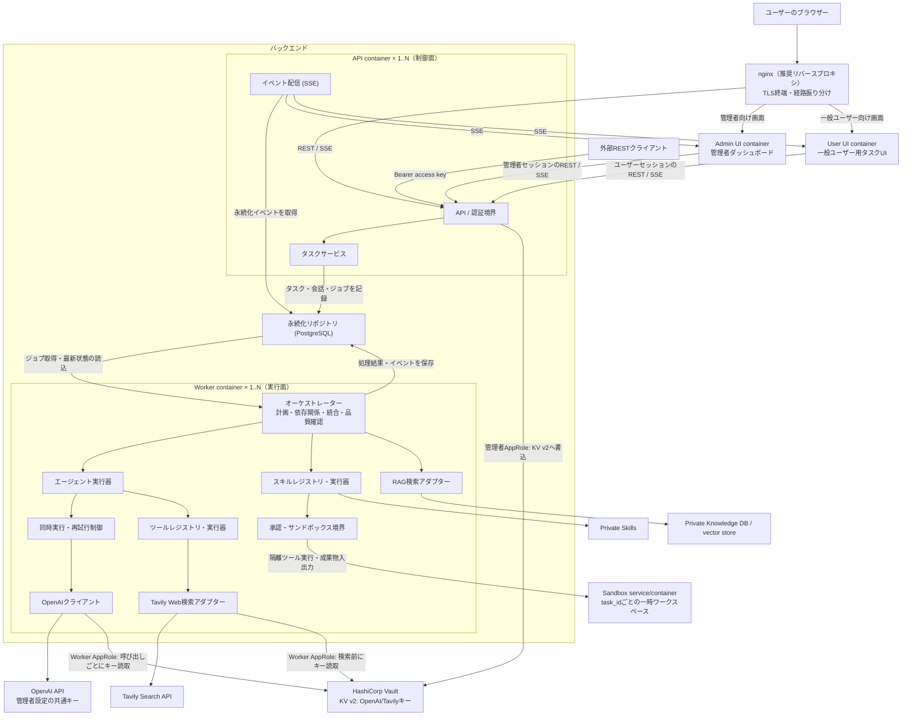
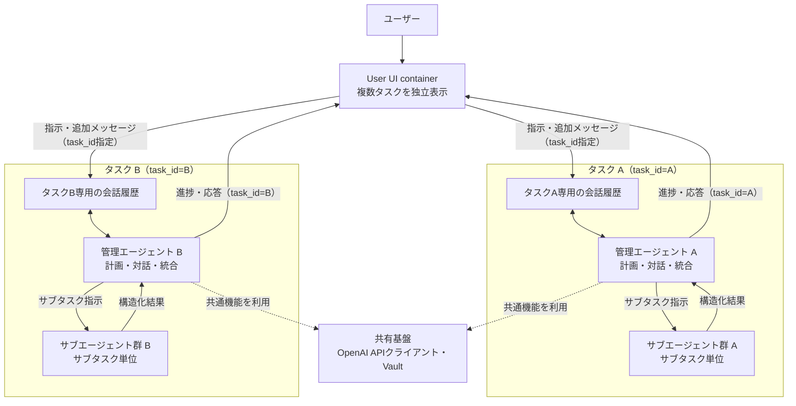
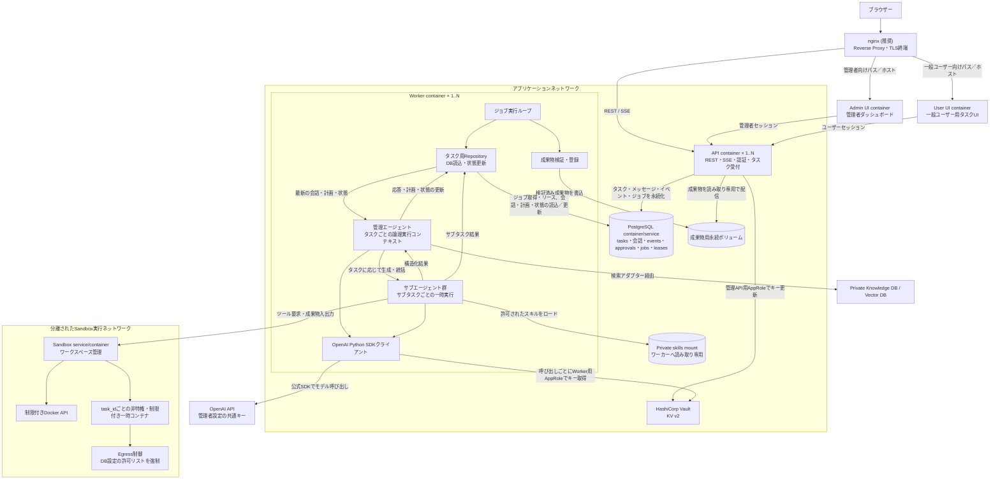
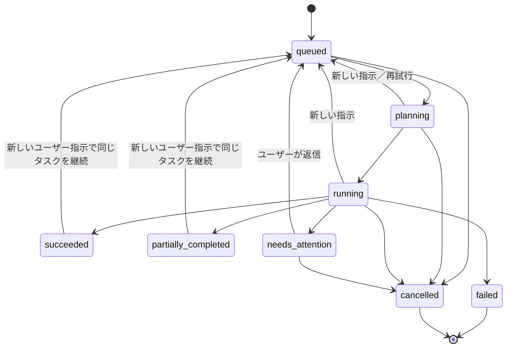
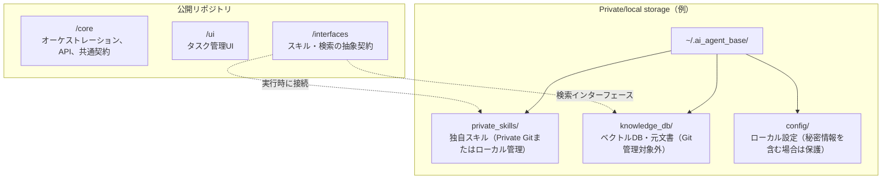

# マルチタスク型AIエージェント基盤 設計書

## 1. 目的と設計方針

本書は [`00_requirements.md`](./00_requirements.md) に定めるマルチタスク型AIエージェント基盤の構成と動作を定義する。ユーザーの複数の指示を独立したタスクとして受け付け、管理エージェントが計画・分割し、必要なサブエージェントを並行実行して結果を統合する。

### 1.1 現行実装との区分

本書には現行実装と将来の目標設計が含まれる。以下の表にない機能は、後続の節に設計記述があっても現行実装済みとはみなさない。現行実装の確認基準はリポジトリの `README.md` とする。

| 区分 | 現行実装（v0.1.0） | 将来設計・未実装 |
|---|---|---|
| 実行基盤 | PostgreSQL、FastAPI、独立API／Worker、PostgreSQLジョブ行のロックと期限付きリース | Worker間のタスク実行リース、fencing token、共有同時実行枠・RPM／TPM制御、複数Worker運用保証 |
| エージェント | 構造化計画、依存関係に沿った読み取り専用サブタスクの並行実行、Tavily検索Function Calling、結果統合、最大3回の設定可能な試行 | 成果物目標・チェックリストによる個別受け入れと最終成果物判定、上限付き品質修正ループ、準完了状態、Tavily以外のツール拡張、ファイル・シェル・外部更新操作、承認、Sandbox |
| 拡張 | Worker内の読み取り専用Tavily Web検索 | 動的プライベートスキル、RAGアダプター、成果物ストレージ、コンテキスト要約 |
| 認証・管理 | WebセッションとCSRF、ユーザー別Bearerアクセスキー、管理者によるアカウント・モデル設定・Vaultキー管理 | 品質修正上限の管理、より細かな権限・監査、利用量／コスト集計 |
| UI・イベント | User UI、Admin UI、DBイベントのSSE配信とLast-Event-ID以降の再送 | チェックリスト判定の進捗表示、準完了の表示、承認／副作用解決UI、成果物UI |

この表は機能の有無を示す。後続節で将来設計を説明する場合は、その節で未実装であることを明記する。

設計上の基本方針は以下のとおり。

1. **コアと独自資産を分離する**: 公開コアには汎用制御と抽象インターフェースのみを置き、独自スキル・ナレッジ・元文書は非公開領域に置く。
2. **外部APIと副作用を制御する**: OpenAI API呼び出しは共通クライアントに集約し、レート制御・リトライ・監査を行う。ファイル変更や外部API実行は承認とサンドボックスを経由させる。
3. **中断から復旧できる**: タスク、サブタスク、イベント、承認状態を永続ストアへ逐次保存する。再起動時に安全に再開できない処理は自動再実行せず、状態を明示してユーザー判断を求める。
4. **モデルや外部実装に依存しない**: モデルID、スキル、検索基盤、実行バックエンドは設定またはインターフェースを通じて切り替える。

## 2. スコープと前提

### 2.1 対象範囲

- タスク管理UIおよびバックエンドAPI
- 管理エージェントによる計画、サブエージェント統括、成果物の統合
- 管理者が設定するシステム共通OpenAI APIキー認証
- 共通ツール連携、Tavilyによる一般Web検索、スキルの動的ロードとRAG検索インターフェース
- 承認フロー、サンドボックス実行、永続化、再開処理
- リアルタイムイベント配信

### 2.2 前提・制約

- 開発・テスト・本番のすべてでPostgreSQLを使用し、SQLiteには対応しない。PostgreSQLはアプリケーション状態の唯一の正規ストアとする。APIとワーカーを分離し、コンテナ数を増やしてもタスク状態とジョブ状態が一貫する構成を基本とする。
- バックエンドはPython（非同期実行、プライベートPythonスキルのロードとの親和性）、HTTP APIはFastAPIを採用する。フロントエンドはTypeScriptベースとし、管理者ダッシュボードと一般ユーザー用タスクUIを別々のコンテナとして配信する。
- バックエンドがPythonであるため、OpenAI API接続には公式OpenAI Python SDKを直接利用する。API呼び出しに必要な公式SDKを用いながら、計画、Tool Callingのループ、サブエージェント制御、永続化・再開を基盤側で制御し、PostgreSQLを唯一の状態正本として保つ。OpenAI Agents SDKのAgent／Runner状態管理には依存しない。
- モデル名は設定値とする。GPT-6系の名称は要求上の例であり、利用可能な実モデルID・API機能を実行環境で確認して設定する。特定のモデル名や機能をコードに固定しない。
- 非公開ナレッジ向けVector DB／RAG検索は将来拡張であり、現行実装には含まれない。一般Web検索はWorkerからTavilyアダプターを通じて実行する読み取り専用ツールとして実装し、RAGとは別の経路で扱う。
- ネットワークから切断中に新たなモデル応答を生成することはできない。現行実装はジョブリース失効後の再取得を行うが、途中計画からの復元ではなく、会話を再読込してタスク処理を再試行する。

## 3. システム構成
以下の図は将来の目標構成である。現行コードにはAPI、Worker、PostgreSQL、Vault、User/Admin UI、nginxと、Worker内のTavily読み取り専用検索がある。追加のツール登録、Skill Registry、Sandbox、RAG、成果物ストレージ、Worker間共有レート制御は未実装である。



### 3.1 コンポーネント責務

| コンポーネント | 責務 |
|---|---|
| Admin UI container | 管理者専用の画面を配信。ユーザー管理など管理者権限を要する操作を提供 |
| User UI container | 一般ユーザー専用の画面を配信。ログインユーザー自身のタスク・アカウント操作を提供 |
| API層 | 入力検証、セッション／Bearerアクセスキー認証、タスク・会話・アカウント・管理設定操作、SSE接続を提供。タスクの所有者を検証し、OpenAIキーをクライアントに返さない |
| タスクサービス | 永続DBを介したタスク受付・状態変更・ジョブ登録を行う。エージェント実行はWorkerへ委譲する |
| オーケストレーター | Worker内で会話履歴を読み、計画生成、依存関係に沿った読み取り専用サブタスク実行、結果の検証・統合を行う。追加メッセージは実行チェックポイントで検出して再計画する |
| エージェント実行器 | 管理エージェント／サブエージェントのプロンプトとコンテキストを構築し、モデル呼び出しを行う |
| OpenAIクライアント | Vaultから取得したシステム共通キーで公式OpenAI Python SDKを呼び出し、タイムアウト、Structured OutputsからJSONへのフォールバック、限定的な再試行を行う。共有RPM／TPM制御・利用量計測は未実装 |
| Worker | PostgreSQLのジョブを `FOR UPDATE SKIP LOCKED` で取得し、期限付きジョブリースを更新しながらタスクを実行する |
| ツール／スキル／Sandbox／RAG | Tavilyの読み取り専用検索をWorkerに実装。Tavily以外の追加ツール、動的スキル、Sandbox、RAGは将来の拡張設計 |
| 永続化 | PostgreSQLにユーザー、セッション、設定、タスク、会話、サブタスク、イベント、ジョブを保存する。承認・成果物・要約・タスク実行リースは未実装 |
| SSE配信 | PostgreSQLに保存済みのイベントを取得して順序付きでクライアントに配信し、Last-Event-IDによる再接続を支援 |

## 4. エージェント構成と通信

### 4.1 エージェント構成

現行実装では、各タスクに一意な`task_id`と独立した会話履歴、サブタスク、イベント、ジョブを保存する。Workerは実行開始時に会話を読み込み、計画とサブタスク要求にその履歴を使う。最終統合前には会話を再読込し、チェックポイントで追加メッセージのsequenceを確認する。別タスクの会話をプロンプトへ混在させない。完了済み計画の復元やWorker間のタスク実行リースは実装していない。

追加指示は会話へ追記する。実行中は現在のモデル要求／サブタスクを中断せず、処理チェックポイントで新しいメッセージを検出すると現在のジョブを完了扱いにして新しいジョブを登録する。次の実行は会話全体から計画を作り直す。`needs_attention`は副作用の確認状態ではなく、現行実装ではサブタスクがユーザーへの追加質問を返した状態であり、ユーザーの返信によって再キューされる。

管理エージェントは計画と統合を行い、サブタスク要求には会話、指示、計画要約、依存先の結果を渡す。現行Workerは1レプリカ運用を前提とし、DBジョブリースはあるが、異なるWorker間のタスク単位排他や共有レート制御は提供しない。



会話履歴はタスク作成時から永続化し、SSE再接続後もAPIから再取得できる。現行実装は会話全件を計画要求へ渡し、統合要求では会話全件とサブタスク結果を渡す。要約・プルーニングは未実装であり、長期タスクのコンテキスト上限を扱う設計は将来課題である。

### 4.2 管理エージェント

現行実装ではモデル名、タイムアウト、最大試行回数を設定する。temperature等のモデルパラメーターは管理設定に含まれない。責務は次のとおり。

1. ユーザー指示と会話コンテキストから目的・制約・完了条件を抽出する。
2. 必要に応じて、依存関係を持つサブタスク計画を構造化出力で生成する。
3. 各サブタスクに指示と依存関係を割り当てる。スキル選択・実行パラメーターの割当は行わない。
4. 依存関係を満たしたサブタスクを並行実行し、結果と失敗を収集する。
5. サブタスク結果を統合し、`completion_met`と注意事項を含むユーザー向け応答を生成する。

計画出力はPydanticスキーマで検証し、依存先の範囲、重複、自己依存、循環を拒否する。スキーマ検証に失敗した場合は設定済みの最大試行回数内で再要求する。

#### 目標設計: 成果物の受け入れとタスク完了

目標設計では、管理エージェントは最新のユーザー指示からタスク全体の目的・制約・最終成果物チェックリストを作成し、計画の各サブタスクに成果物目標と個別の受け入れチェックリストを割り当てる。チェック項目はユーザー要求に由来する判定可能な表現とし、必須項目と任意の品質目標、確認に必要な成果物・根拠、機械的に検証可能かモデル判断を要するかを区別する。要求が曖昧で重要な判断を一意に定められない場合は、推測で必須条件を追加せず、`needs_attention`でユーザーに確認する。

チェックリストは計画バージョンに属し、ユーザー指示の会話sequenceとともに保存する。成果物の受け入れ判定後に、未達を隠す目的で基準を書き換えてはならない。ユーザーの追加指示、前提の誤り、依存タスクの欠落などにより計画または基準を変更する場合は、新しい計画バージョンを作り、変更理由を記録する。既に受け入れた成果物の再検証要否も、変更された依存関係とチェック項目に基づいて管理する。

管理エージェントは、依存関係を満たしたサブタスクを設定上限内で並行実行し、成果物ごとに個別チェックリストで受け入れ判定を行う。受け入れ可なら依存先として利用可能にし、残るサブタスクがあれば次の実行可能なサブタスクを開始する。受け入れ不可なら未達項目と不足根拠を具体的に示して、原則として不足部分だけを修正させ、同じチェックリストで再判定する。未達原因が計画・前提・依存関係の欠陥であれば、必要な情報を補い、計画バージョンを更新して欠落作業を追加する。

全サブタスクが受け入れられ、ユーザーへ応答するための作業が残っていない場合、管理エージェントは結果を統合して最終成果物を作成し、サブタスク用とは独立した最終チェックリストで判定する。全必須項目が満たされた場合だけ`succeeded`とする。品質修正上限に達して未達項目が残る場合は、未達内容を明示した回答を作成し、タスクを`partially_completed`として確定する。モデル・ツール・DBなどの実行障害は品質未達と区別し、通常の`failed`として扱う。

チェック項目は、スキーマ検証、件数、リンク形式、テスト結果など機械的に確かめられるものをコードで判定し、内容の妥当性などモデル判断が必要なものを管理エージェントが判定する。モデル評価だけに依存する項目では、チェック項目ごとの判定、簡潔な根拠、成果物中の証拠位置を記録する。隠れた思考過程は保存しない。

### 4.3 サブエージェント

現行実装ではサブタスクごとに設定済みWorkerモデルを用い、同一タスク内の独立した依存関係レベルを最大32件まで並行実行する。必要に応じてTavilyの読み取り専用Web検索を呼び出せる。出力は `SubtaskResult`（`succeeded`／`needs_input`／`failed`、summary、findings、sources、tool_runs、questions、error）で検証する。サブタスク個別の再開、動的スキル実行、Worker間の共有レート制限はない。

目標設計では、サブタスクの構造化出力に、割り当てられた成果物目標に対応する成果物と、その内容を確認できる根拠を含める。サブエージェント自身の自己評価は参考情報として扱い、受け入れ可否は管理エージェントのチェックリスト判定で決める。修正要求には未達項目、確認済みの前提、期待する差分を含め、サブエージェントにチェックリスト全体を再解釈させず不足範囲を修正させる。

### 4.4 Tool Callingと構造化データ

現行Workerはサブタスク実行に限りResponses APIのFunction CallingでTavily検索を呼び出す。ツール名と引数を登録内容・JSON Schemaで検証し、呼び出しは1サブタスクにつき最大3回とする。計画、サブタスク結果、統合応答は引き続きPydanticモデルのStructured Outputsで要求し、未対応の場合は通常JSONへ切り替えて同じスキーマで検証する。Tavily以外のツール実装と副作用ツールは未実装である。

現行実装のサブタスク結果:

```json
{
    "status": "succeeded",
        "summary": "サブタスクの要約",
    "findings": [],
        "sources": [],
        "tool_runs": [],
    "questions": [],
    "error": ""
}
```

`needs_input`の場合は `questions` に1件以上の質問を必須とし、Workerは質問をassistantメッセージとして保存してタスクを `needs_attention` にする。統合応答は `answer`、`completion_met`、`caveats` を持つ。成果物やツール実行結果は現行スキーマに含まれない。

## 5. Dockerコンテナ構成

### 5.1 採用方針

現行Composeでは**API（制御面）とWorker（実行面）を分離**している。Workerは`agent`プロファイルで起動し、初期運用では1レプリカに限定する。DBジョブ行のロックはあるが、複数Workerに対するタスク単位排他・共有同時実行制御の保証は未実装であり、水平拡張は現行運用の対象外である。

アプリケーション全体を単一コンテナにまとめる方式は、ローカルの試作やデモには簡便だが、本番の標準構成には採用しない。APIの応答処理と、モデル待ち・ツール実行など時間の長い処理が同一プロセス／コンテナの資源を競合するためである。また、ワーカー障害や再起動がAPI・SSE接続まで巻き込み、負荷に応じた独立スケールや実行権限の分離が難しくなる。APIとワーカーを分けることで、APIは軽量な受付・認証・イベント配信を維持し、ワーカーはジョブの同時実行数とCPU・メモリ制限を独立して調整できる。ワーカーが停止しても未完了ジョブはDB上に残り、復旧後にリース期限切れジョブを回収できる。

PostgreSQLをアプリケーション状態のストアとジョブキューに使用する。タスク、会話、イベント、ジョブの受付登録は同じDBセッションでコミットする。Workerは`FOR UPDATE SKIP LOCKED`でジョブを取得し、期限付きリースを更新する。リース切れジョブは再取得され、Worker処理失敗は設定回数まで再試行される。現行実装は副作用ツールを持たないため、冪等性キーや外部副作用の実行記録はない。

ComposeにはPostgreSQL、API、Worker、User UI、Admin UI、nginxがある。Vaultはローカル開発用プロファイル、マイグレーションと初期管理者作成はセットアップ用プロファイルで起動する。Sandbox、制限付きDocker API、成果物ボリューム、RAGサービスはComposeに含まれない。

### 5.2 コンテナ構成図

以下の図は将来の目標構成であり、Sandbox・成果物・プライベートスキル・RAG部分は未実装である。現行ComposeはAPI、Worker、2つのUI、nginx、PostgreSQLと任意の開発用Vaultで構成する。管理者ダッシュボードと一般ユーザー用タスクUIは独立したコンテナに分離する。

リバースプロキシにはnginxを推奨する。初期デプロイは単一ホスト上のコンテナ構成であり、nginxはTLS終端とUI/APIへの経路振り分けを担う。SSE向けにプロキシバッファリングを無効化し、長時間接続を許容するタイムアウトを設定する。実行環境の標準基盤などに別のリバースプロキシ要件がある場合は差し替え可能とする。

コマンド実行にはタスクごとの非特権・リソース制限付き一時コンテナを使用する。コンテナの作成・破棄を担当するSandboxサービスだけが制限付きDocker APIへ接続し、WorkerにはDocker制御権限を与えない。Sandboxサービスは`task_id`ごとの作業領域を管理し、`needs_attention`中は作業領域を保持する。タスクが再開して正常終了するか、ユーザーが終了を選択したときに一時コンテナと作業領域を破棄する。成果物は作業領域から検証後に独立した永続ボリュームへ移し、タスクの存在中は保持する。



### 5.3 コンテナ責務と運用

| コンテナ／サービス | 責務 | スケール・永続化 |
|---|---|---|
| nginx（推奨） | TLS終端、外部からの入口、管理者UI・一般ユーザーUI・APIへのルーティング | リバースプロキシ用コンテナとして配置する。UIごとの経路を分離し、SSEではバッファリングを無効化して長時間接続を許可する |
| Admin UI | 管理者ダッシュボードの静的資産を配信 | 独立したステートレスコンテナ。一般ユーザー用UIの資産と混在させず、秘密情報を含めない |
| User UI | 一般ユーザー用タスクUIの静的資産を配信 | 独立したステートレスコンテナ。管理者専用画面・権限情報を含めない |
| API | REST、SSE、認証、入力検証、会話・アカウント・管理操作、DBへの受付記録 | 現行Composeでは1サービス。API自体にプロセス内タスク状態を保持しない |
| Worker | DBジョブの取得、ジョブリース更新、タスク計画・読み取り専用サブタスク実行・統合 | `agent`プロファイルで起動。初期運用は1レプリカ |
| PostgreSQL | ユーザー、セッション、設定、タスク、会話、サブタスク、イベント、ジョブを保存 | Composeの名前付きボリュームを使用。マイグレーションはセットアップ用サービスで適用 |
| Sandbox／成果物ストレージ | 現行実装なし | 将来設計。Workerから隔離した実行環境と専用成果物保存先が必要 |
| HashiCorp Vault | KV v2でシステム共通OpenAI APIキーを保存 | 管理APIは書込専用の限定AppRole、Workerは読取専用AppRoleを使用 |

プライベートスキル、ナレッジDB、Sandbox、成果物に関するこの節の説明は将来設計であり、現行の実行経路には存在しない。現行実装ではシェル、ファイル変更、外部更新操作を公開しない。Vault AppRoleの読取／書込分離と、秘密値をDB・UIへ返さない処理は実装済みである。

Sandboxと成果物の隔離・配信、外向き通信の制御は将来の安全境界として設計する。これらのサービスが追加されるまでは、Workerはホスト操作や副作用を実行しない。

APIはタスク、初期メッセージ、イベント、ジョブをDBへコミットしてから受付成功を返す。Workerはジョブの期限付きリースを定期更新する。リース切れジョブは再取得可能だが、副作用の不確定状態を識別する機能はなく、現行Workerの失敗時はジョブ／タスク試行回数に応じて再試行または`failed`になる。

### 5.4 Workerとエージェントの状態管理
現行実装ではWorkerがジョブをリース取得し、タスク会話から計画を作成して読み取り専用サブタスクを実行する。以下に記載するタスク単位実行リース、fencing token、途中状態からの復元、共有Worker間排他は目標設計であり未実装である。

管理エージェントとサブエージェントは独立したコンテナではなく、Workerコンテナ内で起動・破棄される論理的な実行単位とする。管理エージェントはタスクごとに一つの調整コンテキストを持ち、そのタスクの会話を処理し、必要なサブエージェントを生成・統括する。サブエージェントは割り当てられたサブタスクの範囲で動作し、会話履歴全体ではなく実行に必要な情報と依存タスクの成果だけを受け取る。サブエージェントの結果は管理エージェントへ返され、Workerが永続化する。

目標設計では、計画バージョン、タスク全体とサブタスクごとのチェックリスト、成果物参照、項目ごとの受け入れ判定、品質修正回数をPostgreSQLへ保存する。Worker再起動後は保存済みの計画・判定から再開し、受け入れ済み成果物を理由なく再実行しない。判定確定、成果物保存、対応イベントの追加は同一トランザクションで行い、イベントは状態の正本ではなく通知・監査用の補助記録とする。

**PostgreSQLをタスク状態・会話履歴の唯一の正本とし、Worker間で会話履歴キャッシュを共有・永続化しない。** Workerはジョブ取得時に`task_id`を使って対象タスク、未処理の会話メッセージ、現在の計画、サブタスク状態、関連する要約・成果物をDBから読み込む。長時間実行中もユーザーの追加指示や別プロセスによる状態変更を反映するため、管理エージェントの各判断チェックポイント（モデルへの次の依頼、計画更新、サブタスク起動、ユーザー応答の確定）でDBを再確認する。モデルへ送る会話コンテキストは、最新の永続化済み履歴とタスク状態からその都度組み立てる。履歴が大きい場合は保存済み要約と必要な直近メッセージを取得し、全履歴を毎回無制限に読み込まない。

モデル応答やサブエージェント出力を得た後は、会話メッセージ、計画・サブタスクの変更、成果物参照、イベント、ジョブ進捗をDBトランザクションで保存してから処理を次へ進める。モデルのストリーミング中間トークンを履歴の確定データとして扱わず、UI向けに配信する場合も完了したメッセージや進捗イベントを正本の更新と区別する。Workerが停止した場合、コンテナ内メモリにしかない会話・計画状態は破棄され、次のWorkerがDBから必要な状態を読み直して再開する。

各タスクの管理エージェント処理は同時に一つだけ実行する。ジョブリースに加えてPostgreSQL上で`task_id`単位の実行リースを取得し、リース保持者のみが会話ターンや計画を確定できるようにする。リース取得・更新には期限と所有者を記録し、期限切れやWorker停止後は別Workerが引き継ぐ。メッセージ追加が長時間処理と競合した場合は、追加メッセージを先にDBへ確定し、実行中Workerが次のチェックポイントで読み込む。リースを失ったWorkerは新たなツール実行を開始せず、実行中のサブエージェントとツール呼び出しへキャンセルを伝播し、状態を書き戻さない。外部副作用を取り消せない場合は実行結果を不確定として記録し、自動再実行を避ける。これにより、DBの状態をWorker内の古いメモリーで上書きしたり、複数Workerが同じタスクの管理ターンを並列に進めたりすることを防ぐ。

この方式ではモデル呼び出し前後や判断チェックポイントごとにDBアクセスが発生するが、Worker再起動後の復旧、Worker間の状態一貫性、タスク別会話の分離を単純なルールで実現できる。会話全体をWorkerメモリーへ長期キャッシュする最適化は初期設計では行わない。将来読み取りキャッシュが必要になった場合も、キャッシュは破棄可能な性能最適化に限定し、更新順序・無効化・排他の正本として利用しない。

コンテナは非rootユーザーで実行し、読み取り専用ルートファイルシステム、明示的なCPU・メモリ上限、ヘルスチェック、graceful shutdownを設定する。Worker終了時は新しいジョブの取得を止め、実行中ジョブの状態・リースを安全に解放または期限切れにする。Compose等の単一ホスト構成は初期デプロイに適するが、高可用性や複数ホストへの拡張時にはPostgreSQLをマネージドサービス等へ移し、ジョブのリース・排他制御が全ワーカーで共有されることを維持する。

## 6. タスク実行・状態管理

### 6.1 状態遷移

タスク状態:



- `queued`: 受付済みまたは再実行待ち
- `planning`: Workerが計画を生成中
- `running`: 現行実装ではサブタスクまたは結果統合を実行中。目標設計ではサブタスク実行、品質レビュー、修正、最終成果物判定を含む
- `waiting_approval`: DB制約上定義されているが、現行実装では使用しない
- `succeeded`: 完了条件を満たして正常終了。追加メッセージで同一タスクを再キューできる
- `partially_completed`: 目標設計で使用する状態。品質修正上限まで処理したが必須チェック項目に未達が残り、未達内容をユーザーへ提示して応答を確定した状態。`error`とは区別し、追加メッセージで同一タスクを再キューできる
- `failed`: モデル・ツール・DBなどの実行障害、または回復不能な処理エラーでタスクを完了できなかった状態。追加メッセージでは再開できない
- `cancelled`: キャンセルAPIにより終了。追加メッセージでは再開できない
- `needs_attention`: サブタスクがユーザーからの追加情報を求めて停止中。会話への返信で再キューする。副作用の結果確認や承認期限切れを意味しない

状態更新と対応イベントは同じDBセッションでコミットする。DB制約には`waiting_approval`等も列挙されているが、全遷移を検証する共通状態機械はない。サブタスクのDB制約上の状態は`pending`、`ready`、`running`、`waiting_approval`、`succeeded`、`failed`、`blocked`、`cancelled`であり、現行Workerは主に`pending`、`running`、`succeeded`、`failed`、`blocked`を使用する。

目標設計ではタスク状態のDB制約に`partially_completed`を追加する。サブタスクは実行状態と受け入れ状態を区別し、少なくとも`pending`、`ready`、`running`、`reviewing`、`revising`、`accepted`、`failed`、`blocked`、`cancelled`を扱う。成果物生成が成功しただけでは`accepted`にせず、管理エージェントの個別チェックリスト判定が受け入れ可となった場合にのみ受け入れ済みとする。状態変更、品質判定記録、対応イベントは同一トランザクションで永続化する。

タスクは`succeeded`後も会話スレッドとして保持する。目標設計では`partially_completed`も会話スレッドとして保持し、`succeeded`、`partially_completed`または`needs_attention`中の新規メッセージは同一トランザクションで保存し、タスクを`queued`にしてジョブを登録する。`queued`、`planning`、`running`の間に届いたメッセージは保存し、Workerがチェックポイントで新sequenceを検出した場合に再キューする。`failed`と`cancelled`は追加メッセージで継続できない。承認待ちは現行実装に存在しない。

目標設計では、既存のエラーコード`completion_criteria_not_met`を廃止し、タスクの`error.code`として出力しない。このコードを実行障害のコードへ単純に読み替えることもしない。品質修正上限後の未達は`partially_completed`状態と構造化された完了レポートで表し、`error`は実行障害に限定する。`partially_completed`は結果の削除、一覧、追加指示などにおいて応答確定済みとして扱うが、`succeeded`とは明確に表示・集計を分ける。

現行の`needs_attention`では、Workerが重複を除いた質問をassistantメッセージとして保存し、処理ジョブを完了する。ユーザーが通常のメッセージAPIで回答すると新しいジョブを登録する。操作結果確認用のresolve API、承認期限管理、Sandbox保持・破棄は実装されていない。

### 6.2 実行シーケンス

1. UIが指示をREST APIへ送信する。APIは入力を検証し、`queued`タスク、初期メッセージ、イベント、ジョブをDBへコミットしてからタスクIDを返す。
2. Workerが`FOR UPDATE SKIP LOCKED`でジョブを取得し、期限付きリースを設定してタスクを`planning`にする。
3. Workerはタスク設定スナップショットと会話履歴を読み、管理モデルで計画を生成する。計画にはバージョン、タスク全体の最終チェックリスト、各サブタスクの成果物目標・依存関係・受け入れチェックリストを含め、検証後にDBへ保存する。
4. 依存関係を満たすサブタスクを設定上限内で並行実行し、成果物・状態・進捗イベントをDBへ保存する。`needs_input`があれば質問をassistantメッセージとして保存し、タスクを`needs_attention`にしてジョブを終了する。
5. 管理エージェントは各成果物を個別チェックリストで判定し、チェックリスト項目ごとの結果・根拠を記録する。受け入れ可なら依存先として後続タスクへ渡す。受け入れ不可なら未達項目に限定した修正指示を出し、品質修正上限内で再判定する。計画上の欠落や誤った前提が見つかった場合は、理由を記録して計画バージョンを更新し、必要な依存タスクを追加する。
6. 実行チェックポイントで新しいユーザーメッセージを検出した場合、現在のジョブを完了し、新しいジョブを登録する。再実行時は最新会話sequenceに基づく新しい計画バージョンを作成し、古い判定記録を履歴として保持する。
7. 全サブタスクが受け入れられ、ユーザー応答のための作業が残っていない場合、管理モデルで成果物を統合し、タスク全体の最終チェックリストを判定する。全必須項目が満たされれば`succeeded`、品質修正上限後も未達があれば不足内容を含む応答を保存して`partially_completed`とする。実行障害は`failed`、ユーザー回答待ちは`needs_attention`とする。
8. 最終回答、完了レポート、判定記録、タスク状態、イベント、ジョブ状態をDBトランザクションで保存する。UIには状態とユーザー向け進捗・未達要約を表示し、モデルの隠れた思考過程は表示・保存しない。

キャンセルAPIはタスクを`cancelled`にし、未完了ジョブを完了扱いにする。進行中のOpenAI要求に即時キャンセルを伝播する仕組みはなく、要求は応答またはタイムアウトまで継続し得る。その後のWorker書き込みはジョブリース検査で拒否される。副作用操作の不確定状態確認は未実装である。

追加指示は専用APIで会話へ保存する。実行中は進行中のモデル要求を中断せず、Workerがチェックポイントでsequenceの増加を検出した後、新しいジョブを登録して全会話から再計画する。`needs_attention`への返信と`succeeded`後の追加指示も新しいジョブを登録する。承認状態との連携はない。

### 6.3 リトライとレート制御

- モデル要求は設定された試行数（1〜3回）まで行う。接続エラー、HTTP 429、HTTP 5xxは指数バックオフとジッターで再試行し、数値形式の`Retry-After`があれば優先する。Structured Outputsの検証失敗は修正を促して再要求する。
- Worker処理全体も同じタスク設定の試行上限まで再試行し、待機時間は指数的に増加して最大30秒となる。モデル要求の内部試行とWorkerジョブ試行は別の上限である。
- タスク内サブタスクの並行数は1〜32で設定する。Workerレプリカ間で共有するRPM／TPMレート制御や同時実行枠は未実装である。

目標設計の品質修正回数は、形式・API障害やWorkerジョブ再試行とは別の設定として管理する。管理画面でサブタスク単位の最大品質修正回数と、1タスク全体の最大品質修正回数を設定可能にし、いずれも有限の範囲に制限する。新規タスク作成時に両設定を`config_snapshot`へ保存し、実行中の管理設定変更で既存タスクの上限を変えない。上限到達後にチェックリストを緩和して成功扱いにせず、未達項目と根拠を完了レポートへ記録して`partially_completed`にする。追加計画・再計画もタスク全体の品質修正予算を消費する。

### 6.4 コンテキスト管理

要約・履歴プルーニング・要約イベントは未実装である。現行Workerは計画と最終統合の入力に会話全件を使用するため、会話の長さに応じてモデルのコンテキスト上限へ達する可能性がある。

## 7. ツール・スキル・RAG
この節には現行実装と将来拡張の設計を記載する。現行Workerには共通のツール登録・Function Calling実行境界とTavily検索ツールがある。動的スキルロードとRAGアダプターは未実装であり、現行の計画スキーマでも`skill_names`は受け付けるが、Workerは非空のスキル指定をエラーとして拒否する。

### 7.1 スキルインターフェース

コアはスキル実装ではなく、次の契約を定義する。

- 一意なスキル名とバージョン
- OpenAI Tool Calling互換の引数JSON Schema
- リスク分類（`read_only`、`writes_data`、`external_side_effect`）
- 非同期実行関数、タイムアウト、実行環境要件
- 構造化された成功結果またはエラー

登録時に重複名、破損したSchema、未許可パスを検査する。ロードできないスキルが設定されている場合、起動・タスク開始時に診断可能なエラーとして通知する。起動時ロードを基本とし、タスク実行中の無検証なコード再ロードは行わない。

### 7.2 プライベート資産の配置



実パスは設定で変更できる。プライベートパス、DBファイル、ログ、元文書、認証情報は公開リポジトリに追加しない。`.gitignore`と配布設定でローカルデータの誤コミットを防ぎ、起動時に設定済みパスが公開リポジトリ内を指していないか警告・検査する。

### 7.3 検索インターフェース

検索アダプターは、クエリ、件数上限、任意のメタデータフィルターを受け取り、文書ID、関連箇所、スコア、出典メタデータを返す。Vector DBの認証情報・接続先はサーバー側設定に置く。コアは文書のインデックス作成・削除や具体的な埋め込み方式を固定せず、外部実装の責務とする。検索結果は出典情報付きでタスク履歴に記録する。

### 7.4 共通ツール連携

ツールはモデルやエージェント固有の実装から分離し、Public側の共通契約と登録済みアダプターを通じて実行する。現行実装はWorkerに共通Tool Registry／Function Calling境界を持ち、Tavily検索だけを登録する。ツール定義は一意な名前・バージョン、説明、引数JSON Schema、リスク分類、実行タイムアウト、構造化された結果・エラー形式を持つ。実装は非同期実行を基本とする。Tavilyなど外部サービス固有のAPI形式は各アダプター内に閉じ込め、オーケストレーターとエージェントには共通形式だけを見せる。複数ツールの管理UIは将来拡張である。

Tool Callingの制御ループと実行判断はWorker側が担う。モデルが返したツール名と引数は登録済みツールの許可リストおよびJSON Schemaで検証してから実行し、未登録ツールや不正な引数は実行しない。承認機構が未実装の現行Registryは`read_only`以外のツールをモデルへ公開せず、実行要求も拒否する。ツールの利用可否はタスク実行時の設定で制限し、モデル出力だけで権限やネットワーク許可範囲を拡張できないようにする。ツールの実行要求・結果・エラーはタスクに紐付けて記録し、再試行はリスク分類と冪等性を考慮する。副作用を伴うツールは承認境界を通し、ファイル・シェル操作はWorker上で直接実行せずSandboxへ委譲する。

ツールが外部サービスへ送信する情報は、実行に必要な最小限の入力に限定する。会話全体、システムプロンプト、認証情報、その他の秘密情報を無条件に転送しない。外部送信がタスク内容の機微性に照らして許可できない場合は呼び出しを行わず、理由をタスク結果に示す。ツール応答や取得文書は信頼できないデータとして扱い、その中の指示をシステム指示やユーザー指示として実行しない。

### 7.5 Tavilyによる一般Web検索

一般情報のWeb検索には、AIエージェント向け検索サービスであるTavilyを採用する。Public側にTavilyアダプターを実装し、現行Workerではサブタスクから共通ツール契約を介して呼び出す。Tavily固有のリクエスト・レスポンス形式はアダプターで変換し、他の検索プロバイダーへ移行する場合も共通ツール契約とエージェント側の利用方法を維持できるようにする。現行ツールが受け付ける引数は検索queryと結果件数（1〜5件）に限定する。

このWeb検索は公開Web上の一般情報を対象とし、非公開ナレッジを検索するRAG／Vector DBとは別のツールとして扱う。検索結果はタイトル、URL、抜粋、検索スコア、公開日を正規化する。実際に返った出典はプロバイダー名・取得時刻とともに`subtasks.result`へ保存し、統合回答ではそのURLをMarkdownリンクで引用する。検索結果の内容自体は未検証の外部情報として扱う。

Tavily APIキーはVaultの`VAULT_TAVILY_KEY_PATH`からWorker用AppRoleで読み取り、DB、イベント、ログ、ブラウザーには保存・返却しない。検索要求はTavilyの固定API接続先`https://api.tavily.com/search`に限定し、任意URLへのアクセスや取得ページを起点とした追加リクエストを行わない。安全検索を有効にし、結果は最大5件、応答本文は256 KB、各抜粋は1,500文字に制限する。タイムアウトと再試行回数を設定で制限し、レート制御はWorkerプロセス内で30回／分とする。Worker間で共有するレート制御は未実装である。検索クエリは必要最小限にし、APIキー・Bearer token・メールアドレス等の代表的なパターンを引数検証で拒否する。この検査は一般的な個人情報や秘密情報を完全に検出するものではない。ドメイン許可・拒否リストや検索オプションの管理UIは未実装である。

現行実装は読み取り専用のTavily検索に限定する。汎用ツールの管理機能、他プロバイダー、ドメイン制限設定、外部更新操作は将来拡張であり、導入時には承認・Sandbox等の境界を別途設ける。

## 8. APIとリアルタイムイベント

### 8.1 REST API

UIの認証はサーバー側セッションで行い、管理者UIと一般ユーザーUIで許可する操作を分離する。外部RESTクライアントはユーザー単位のアクセスキーで認証する。すべてのタスク・会話・承認・成果物APIは認証済みユーザーの所有範囲にスコープし、管理者操作は管理者権限を別途要求する。

| メソッド | パス | 用途 |
|---|---|---|
| `POST` | `/api/auth/login` | メールアドレス／パスワードでログインし、サーバー側セッションを発行 |
| `POST` | `/api/auth/logout` | セッションを破棄 |
| `GET` | `/api/auth/me` | ログイン中ユーザーを取得 |
| `POST` | `/api/admin/users` | 管理者が一般ユーザーを登録し、初期パスワードを設定 |
| `POST` | `/api/admin/users/{user_id}/password-reset` | 管理者が初期パスワードを再設定し、次回ログイン時の変更を必須化 |
| `GET` | `/api/admin/operations/tasks` | タスクID、所有者メール、状態、時刻、エラー情報を取得。指示文・会話本文は返さない |
| `GET` | `/api/admin/settings` | アプリ運用設定とVaultキー設定状態を取得。キーそのものは返さない |
| `PUT` | `/api/admin/settings` | アプリ運用設定をPostgreSQLへ保存し、新規タスクの設定として適用 |
| `PUT` | `/api/admin/secrets/openai-api-key` | 管理者がリクエスト本文の`api_key`をVault KV v2へ登録・更新し、成功後に非秘密の設定済み状態を記録。値は応答へ含めない |
| `POST` | `/api/account/password` | ログイン中ユーザーが本人確認後にパスワードを変更 |
| `POST` | `/api/account/access-key` | ログイン中ユーザーのアクセスキーを発行または再発行 |
| `POST` | `/api/tasks` | タスクを作成し、実行をキューに登録 |
| `GET` | `/api/tasks` | 所有タスク一覧を取得。`limit`は1〜100に制限 |
| `GET` | `/api/tasks/{task_id}` | 所有タスクの状態、指示、結果、エラーを取得。目標設計では完了レポートとチェックリスト判定要約を含める。サブタスク一覧は返さない |
| `DELETE` | `/api/tasks/{task_id}` | 現行実装では`succeeded`、`failed`、`cancelled`のタスクを削除。目標設計では`partially_completed`も削除可能 |
| `GET` | `/api/tasks/{task_id}/messages` | タスク固有の会話履歴を時系列で取得 |
| `POST` | `/api/tasks/{task_id}/messages` | タスク固有の会話へユーザー指示を追加し、必要に応じて実行を継続 |
| `POST` | `/api/tasks/{task_id}/cancel` | タスクをキャンセル |
| `GET` | `/api/tasks/{task_id}/events` | `Last-Event-ID`対応のSSEイベントストリーム |
| `GET` | `/api/health` | `{"status":"ok"}`を返す簡易ヘルス応答。依存サービスの診断はしない |

タスク作成要求は`instruction`（1〜20,000文字）を受け取る。追加メッセージは`content`（1〜20,000文字）を受け取る。タスクには認証ユーザーの`owner_id`を設定し、初期タスク、会話メッセージ、イベント、ジョブをDBへ保存してから応答する。タスクAPIはWebセッションまたはユーザー別Bearerアクセスキーを受け付け、ブラウザーセッションの更新要求にはCSRF検証を行う。タスク一覧は`limit`のみ受け付け、状態フィルターやoffset/cursorページングはない。

追加指示はタスク所有者を検証して連番付きで保存する。現行実装では`succeeded`と`needs_attention`、目標設計ではこれらに`partially_completed`を加え、新しいジョブを登録する。`queued`、`planning`、`running`ではWorkerのチェックポイントによる再計画を待つ。`failed`と`cancelled`では追加指示を拒否する。目標設計の完了レポートは未達項目とユーザー向け説明を返すが、隠れた思考過程や他タスクの情報は含めない。入力検証失敗は秘密値を含まない汎用422応答を返す。承認、resolve、成果物APIは現行実装にない。

Worker内のモデル要求とジョブ処理は設定回数まで再試行される。タスク削除は現行実装では終端状態（`succeeded`、`failed`、`cancelled`）のみ許可し、目標設計では応答確定済みの`partially_completed`も対象に含める。外部キーのcascadeにより会話、計画、チェックリスト、品質判定記録、サブタスク、イベント、ジョブを削除する。承認履歴・実行履歴・成果物は現行DBに存在しない。

将来のresolve API、承認決定API、成果物ダウンロードAPIの要求形式と認可・保存方式は、これらの機能を実装する際に別途定義する。

アクセスキーは外部RESTクライアント専用のBearer認証資格情報とし、ログインUIのセッション認証とは分ける。各ユーザーにつき有効なキーは最大1本とする。発行・再発行時に十分なエントロピーを持つキーを生成し、平文は発行応答で一度だけ返し、DBにはハッシュのみを保存する。再発行は旧キーを同一トランザクションで失効させ、自動期限は設けない。一般ユーザーは自身のキーのみを発行・再発行できる。

### 8.2 SSEイベント

イベントは少なくとも単調増加するイベントID、タスクID、時刻、イベント種別、構造化ペイロードを持つ。種別の例:

現行イベント種別:

- `task.status_changed` / `task.cancelled`
- `conversation.message_added`
- `plan.created`
- `subtask.status_changed`
- `agent.progress`
- `task.completed` / `task.failed`

目標設計では`task.partially_completed`に加え、チェックリスト作成・更新と受け入れ判定完了を示す品質イベントを追加する。イベントpayloadには計画バージョン、対象サブタスク、判定結果、短いユーザー向け要約を含める。チェックリストと項目別根拠の正本はDBの計画・判定記録とし、SSEイベントは再取得可能な進捗通知として扱う。

SSEエンドポイントはタスク所有者を検証し、DBのイベントID順に最大200件ずつ読み取る。`Last-Event-ID`以降を再送し、新規イベントがない間は設定間隔（既定1秒）でkeep-aliveを送る。ツール、承認、成果物、要約イベントは現行実装にない。UIは会話本文をイベントへ重複記録せず、必要に応じてメッセージAPIから再取得する。

## 9. データ設計

開発・テスト・本番のすべてでPostgreSQLを正規ストアとして使用し、外部キーを有効化する。SQLiteはサポート対象外とする。状態変更とイベントの追加、およびジョブ登録は可能な限り単一トランザクションで行う。

| テーブル | 主な項目 | 用途 |
|---|---|---|
| `users` | `id`, `email`, `password_hash`, `role`, `is_active`, `must_change_password`, `created_at` | 管理者・一般ユーザーのアカウントと権限。平文パスワードは保存しない |
| `api_access_keys` | `id`, `user_id`, `key_hash`, `created_at`, `revoked_at` | ユーザーにつき有効キーを最大1本保持。ハッシュのみ保存し、自動期限は設けない |
| `web_sessions` | `id`, `user_id`, `session_token_hash`, `csrf_token_hash`, `created_at`, `last_seen_at`, `absolute_expires_at`, `revoked_at` | Web UIのサーバー側セッション。アイドル30分、絶対有効期間12時間。Cookieには不透明なセッショントークンのみを保持 |
| `tasks` | `id`, `owner_id`, `instruction`, `status`, `created_at`, `updated_at`, `result`, `error`, `config_snapshot` | タスク本体と所有者。初期指示と会話履歴を保持し、作成時の実行設定を保存 |
| `system_settings` | `id`, `settings_json`, `openai_key_configured`, `version`, `updated_by`, `updated_at` | 管理画面から変更するアプリ運用設定とOpenAIキー設定済み状態の正本。キー自体・接続先等のデプロイ設定は格納しない |
| `conversation_messages` | `id`, `task_id`, `sequence`, `role`, `content`, `created_at` | タスク固有のユーザー指示と管理エージェント応答を時系列で保存 |
| `subtasks` | `id`, `task_id`, `title`, `instruction`, `status`, `dependencies`, `model_id`, `skill_names`, `attempt`, `result`, `error`, `created_at` | 計画された作業単位、依存関係、結果。目標設計では成果物目標、受け入れチェックリスト、計画バージョン、品質修正回数を追加 |
| `task_plans` | `id`, `task_id`, `version`, `conversation_sequence`, `summary`, `final_checklist`, `change_reason`, `created_at` | 目標設計で追加。タスク計画と最終チェックリストを会話sequenceに結び付け、再計画前の版も保持 |
| `quality_reviews` | `id`, `task_id`, `plan_version`, `target_type`, `target_id`, `revision_round`, `checklist_results`, `verdict`, `created_at` | 目標設計で追加。サブタスク成果物および最終成果物の判定を追記専用で保存 |
| `events` | `id`, `task_id`, `type`, `payload_json`, `created_at` | SSE再送と画面進捗。`subtask_id`列は持たず、必要な識別子はpayloadに含める |
| `jobs` | `id`, `task_id`, `status`, `available_at`, `lease_owner`, `lease_expires_at`, `attempt`, `created_at` | Workerが取得する耐久ジョブキューと期限付きリース |

現行DBには`users`、`system_settings`、`api_access_keys`、`web_sessions`、`tasks`、`conversation_messages`、`subtasks`、`events`、`jobs`の9テーブルがある。目標設計では`task_plans`と`quality_reviews`を追加し、`subtasks`にも成果物目標・チェックリスト・計画バージョン・品質修正回数を保存する。計画バージョンはタスク内で一意とし、品質判定は上書きせず履歴として残す。判定記録にはチェック項目ごとの結果、短い判断根拠、成果物中の証拠参照、判定モデル／評価方式の識別情報を含める。隠れた思考過程は保存しない。タスク所有者以外へチェックリスト本文や根拠を返さず、タスク削除時は関連する計画・判定記録も削除する。

`users.email`は一意、roleは`admin`または`user`、有効なアクセスキーはユーザーにつき最大1本となる部分一意インデックスで制約する。所有タスクAPIは`owner_id`で認可する。管理設定として保存するのはmanager／workerモデル、最大同時サブタスク数、最大試行回数、目標設計で追加する品質修正上限であり、新規タスク作成時に`config_snapshot`へコピーする。承認期限やSandbox許可リストは設定・DBモデルに存在しない。

独立したツール実行テーブルは未実装である。Tavilyの実行要求要約・成否・エラーコードと検索出典は、サブタスクの`result` JSONBに保存する。承認、成果物、利用量、要約、タスク単位リース、共有レート制御のテーブルも未実装であり、将来追加する場合はAPI・状態遷移・データ保持要件に合わせてマイグレーションを設計する。

`jobs`取得ではPostgreSQL行ロック（`FOR UPDATE SKIP LOCKED`）を用い、status／available_at／lease_expires_atのインデックスで期限切れジョブを再取得する。タスク実行リースやfencing tokenはない。`conversation_messages(task_id, sequence)`は一意で、roleは`user`または`assistant`に限定する。イベントはグローバル採番IDを持ち、`task_id`で絞り込んでID順に配信する。タスク／メッセージ／イベント／ジョブの更新は各API・Worker処理のDBセッションでコミットされる。

現行スキーマの主なインデックスは、所有者・更新日時によるタスク一覧、会話sequence、タスク／サブタスク、タスク／イベントID、利用可能ジョブである。`config_snapshot`にOpenAI APIキーは含めない。

### 9.1 再起動時の復旧

現行実装に定期リーパーやタスク／副作用チェックポイントはない。Workerがジョブリースを更新できなくなると実行をキャンセルし、リース期限後に別Workerがジョブを再取得できる。再取得時は会話から新たに計画を作るため、途中計画の復元ではなく処理全体の再実行となる。Workerは初期運用で1レプリカに限定する。

## 10. 安全性・秘密情報

### 10.1 アカウント認証とアクセスキー

- 初期管理者はセットアップ用CLI `create-initial-admin` が`INITIAL_ADMIN_EMAIL`と`INITIAL_ADMIN_PASSWORD`から作成する。既存メールアドレスがあれば作成しない。初期管理者作成はAPI起動時の自動処理ではない。
- 管理者が一般ユーザーを登録するときに初期パスワードを設定し、`must_change_password`を有効にする。初回ログイン後はパスワード変更が完了するまで、パスワード変更以外のAPI操作を許可しない。パスワード忘れ時は管理者が初期パスワードを再設定し、同じく次回ログイン時の変更を必須とする。
- 一般ユーザーはメールアドレスとパスワードでログインする。パスワードは適切な一方向パスワードハッシュとして保存し、本人による変更時には現在のパスワードを再確認する。変更成功時は他の有効セッションを失効させる。
- Web UIはサーバー側セッションを利用する。既定はアイドル30分、絶対12時間で、設定から変更できる。セッションCookieは`HttpOnly`、`SameSite=Lax`であり、`Secure`は`SESSION_COOKIE_SECURE`設定に従う。ブラウザーの状態変更要求ではCSRF Cookie・ヘッダー・保存ハッシュを照合する。タスクAPIのBearer要求はブラウザー用CSRF検証を行わない。
- 外部RESTクライアント用アクセスキーはユーザー単位で一つだけ有効とし、SHA-256ダイジェストのみDBへ保存する。再発行時は旧キーを失効し、新しい平文を応答で返す。独立した失効APIはない。
- タスクAPIは`owner_id`で所有権を検証する。管理者APIは管理者ロールを要求する。管理画面の運用一覧はタスクID、所有者メール、状態、時刻、エラーを返し、会話・指示・成果物・利用量は返さない。アカウントの有効／無効を変更する管理APIはない。

### 10.2 OpenAI APIキー管理

- OpenAI APIキーは管理者が管理者ダッシュボードから登録するシステム共通キーとし、HashiCorp VaultのKV v2に保存する。設定画面は登録済み／未登録の状態だけを表示し、保存済みキーを再表示しない。PostgreSQL、ログ、イベント、ブラウザー永続ストレージにはキーを保存しない。
- キー設定状態は、Vaultへの書込みが成功した後に`system_settings.openai_key_configured`へ記録する非秘密の状態フラグから表示する。管理APIはVaultキーを読み取らず、Vault KVの書込み権限のみを持つ。
- 管理APIとWorkerにはVault AppRoleを別々に割り当てる。管理API用AppRoleは指定KVパスへの書込みに限定し、Worker用AppRoleは読取り専用とする。`role_id`と`secret_id`はDocker Secrets等のアクセス制限された読み取り専用ファイルから取得し、DBやイメージへ格納しない。Vaultのmount/pathはデプロイ設定とする。
- Workerは各OpenAI API呼び出しの直前にVaultから最新キーを取得して公式SDKへ適用する。キー更新は以降の新しい呼び出しに反映される。Vault障害またはキー未設定・無効時はモデル呼び出しを明示的に失敗させ、古いキャッシュ値やダミー値へフォールバックしない。
- APIキーはモデル要求にのみ用い、ユーザーUIへ返さない。Vault障害・キー未設定時はモデル要求を失敗させ、環境変数等のキーへフォールバックしない。キーを含むエラーのログマスキングは別途確認・運用すべき事項である。
- Tavily APIキーは別のKV v2パス（`VAULT_TAVILY_KEY_PATH`）に保存し、Worker用AppRoleだけに読取権限を与える。管理APIはTavilyキーを読み書きせず、運用者がSecret Storeへ登録する。キーを環境変数、DB、イベント、ログ、UIへ複製しない。

### 10.3 承認とサンドボックス
この節は将来設計であり、現行Workerはツール、承認、Sandbox、副作用実行、成果物作成を提供しない。実装前に以下の安全境界を設ける。

- ファイル書き換え、シェルコマンド、外部APIの更新系呼び出しなど副作用を伴うツールは、実行前に承認を要求する。読み取り専用処理も許可されたパス・ネットワーク範囲を超えない。
- 承認対象は操作内容、対象リソース、引数の要約、要求時点の識別子を固定して表示する。承認後に引数が変わった場合は承認を無効化して再確認する。
- コマンド・ファイル操作はWorkerとは分離したSandboxサービス／コンテナで実行する。`task_id`ごとの隔離ワークスペースは複数のツール呼び出し間で維持し、正常終了時に破棄する。`needs_attention`中は解決まで保持し、再開後の正常終了またはユーザーの終了選択時に破棄する。成果物のみを明示的な検証済み経路で取り出し、ユーザー指定のホストパスや資格情報はマウントしない。
- Sandboxからの外向き通信は既定で禁止し、管理者が設定した宛先許可リストに一致する通信のみ許可する。ネットワーク、プロセス権限、CPU・メモリ・実行時間を制限し、ユーザー指示・モデル出力から許可リストを変更できない。
- サンドボックスを利用できない場合、危険な操作をホスト上で代替実行してはならない。該当ツールを失敗または承認不能として報告する。
- スキルコードは任意コード実行能力を持つ信頼境界として扱う。許可されたプライベートソースのみをロードし、ロード元とバージョンを記録する。

### 10.4 UI・ログの安全性

現行APIにはセッション／Bearer認証、更新要求のCSRF検証、Pydantic入力長制限を実装している。FastAPIに明示的なCORSポリシーは設定されておらず、UIはnginx経由の同一オリジンで利用する構成である。入力検証エラーは詳細を返さず、汎用422本文を返す。監査ログの網羅性、秘密情報の全経路でのマスキング、保存期間管理は未実装または別途検証が必要である。

## 11. 障害処理と観測性

現行WorkerはタスクIDと例外型をログに出し、失敗時のコードと短縮メッセージをタスクへ保存する。モデル要求には設定タイムアウトがあり、Workerリースと試行上限で実行を制限する。`/api/health`は固定の`{"status":"ok"}`を返すだけで、DBやVaultの可用性を検査しない。利用量、レート制限、スキル・承認エラーの分類、監査・保存期間管理は未実装である。

目標設計では、実行障害には原因を表す具体的なエラーコード（例: `model_provider_unavailable`、`tool_execution_failed`、`invalid_model_output`）を優先して用いる。原因を特定できない回復不能な実行障害に限り、汎用コード`task_execution_failed`を使う。チェックリスト未達はエラーコードにせず、`partially_completed`と完了レポートの未達項目で表す。エラー応答には秘密情報や内部スタックトレースを含めない。

## 12. UI設計

### 12.1 基本方針

管理者ダッシュボードと一般ユーザー用UIは、別コンテナから独立して配信する。両UIは共通のAPIを利用するが、機能・権限・表示領域を分離する。UIを通じた操作はサーバー側で認証・認可し、ブラウザー上の表示制御だけをセキュリティ境界としない。一般ユーザーのWebログインにはメールアドレス／パスワードとサーバー側セッションを使用し、外部RESTクライアントのアクセスキー認証とは分ける。

### 12.2 管理者向けUI

- 管理者専用セッションと管理者ロールを必須とし、一般ユーザーからアクセスできない独立した管理画面として提供する。
- 管理者が一般ユーザーの登録、初期パスワード設定、パスワード再設定を行う。アカウントの有効／無効切替はない。
- 運用画面にはタスクID、所有者メール、状態、時刻、エラー情報を表示する。会話本文、指示、成果物、利用量・コストは表示しない。
- manager／workerモデルID、タスク内同時サブタスク数（1〜32）、最大試行回数（1〜3）を管理する。目標設計ではこれらに加え、サブタスク単位およびタスク全体の最大品質修正回数を設定する。品質修正回数は形式・API再試行やWorkerジョブ再試行とは別に制限し、設定可能な有限範囲を設ける。保存した設定は新規タスクに適用し、既存タスクは設定スナップショットを使う。承認期限やSandbox通信許可リストは設定項目にない。
- システム共通OpenAIキーをVaultへ登録・更新する。画面には登録済み／未登録の状態だけを表示し、保存済みキーを再表示しない。

### 12.3 一般ユーザー向けUI

- **ログイン**: メールアドレス／パスワードで認証し、サーバー側セッションを開始する。
- **初回ログイン**: 管理者が設定した初期パスワードでログインした場合、本人がパスワードを変更するまで他の画面・APIを利用できない。
- **タスクダッシュボード／詳細**: ログインユーザー自身のタスク一覧、状態、会話、進捗を表示し、新規タスクを作成する。目標設計ではチェックリストの進捗と、最終回答が準完了の場合の未達項目・制約を表示する。ユーザー所有権はAPI側で検証する。
- **タスクへの追加指示**: 実行中の追加指示は会話に保存し、処理中呼び出しの完了・保存後のチェックポイントで反映する。
- **要確認**: `needs_attention`で表示されたエージェントの質問に会話で返信して処理を継続する。承認・副作用結果の解決UIはない。
- **タスク削除**: 現行実装では`succeeded`、`failed`、`cancelled`のタスクを削除できる。目標設計では`partially_completed`も削除できる。成果物ダウンロードはない。
- **アカウント設定**: 本人確認付きパスワード変更と、外部RESTクライアント用アクセスキーの発行・再発行を提供する。アクセスキーは発行時のみ平文表示し、再表示しない。
- **進捗表示**: エージェントの内部思考をそのまま表示せず、状態、進捗要約、実行中ツール、承認待ち、生成された成果物を表示する。通信断時は再接続状態を明示し、SSE再開後にサーバー上の確定状態と同期する。画面上の表示だけをタスク状態の正として扱わない。

## 13. 設定・デプロイ

現行実装の管理画面から変更できる運用設定はモデルID、タスク内同時サブタスク数、最大試行回数に限られる。目標設計ではサブタスク単位とタスク全体の品質修正上限を追加する。Vault接続・DB接続・Cookie設定等は環境設定で与える。設定更新は新規タスクへ適用し、既存タスクは作成時の`config_snapshot`を使う。承認、Sandbox通信許可、利用量・コスト等の設定は存在しない。

| デプロイ設定 | 内容 |
|---|---|
| `POSTGRES_PASSWORD` / `DATABASE_URL` | Compose PostgreSQLの資格情報と接続先。SQLiteはサポート対象外 |
| `MANAGER_MODEL` | 管理者画面での初期設定に用いる管理エージェントのモデルID。必須。未設定時は起動時に明示エラー |
| `WORKER_MODEL` | 管理者画面での初期設定に用いるサブエージェントの既定モデルID。必須。未設定時は起動時に明示エラー |
| `INITIAL_ADMIN_EMAIL` | 初回起動時に作成する初期管理者のメールアドレス |
| `INITIAL_ADMIN_PASSWORD` | 初期管理者作成用の初期パスワード。Secret Store等から一時注入し、初期化後は除去 |
| `SESSION_COOKIE_SECURE` | セッションCookieの`Secure`属性。TLS終端環境ではtrueに設定 |
| `MAX_CONCURRENT_AGENTS` / `MAX_AGENT_ATTEMPTS` | 初期値。最大試行数は1〜3に制限 |
| `MAX_QUALITY_REVISIONS_PER_SUBTASK` / `MAX_QUALITY_REVISIONS_PER_TASK` | 目標設計で追加する管理設定の初期値。品質修正の有限上限であり、モデル/API再試行やWorkerジョブ再試行とは別に設定 |
| `VAULT_ADDR` | HashiCorp Vaultの接続先 |
| `VAULT_KV_MOUNT` | Vault KV v2のmount名 |
| `VAULT_OPENAI_KEY_PATH` | システム共通OpenAIキーを保存するKV v2内のパス |
| `VAULT_TAVILY_KEY_PATH` | Tavily APIキーを保存するKV v2内のパス。Worker AppRoleのみ読取可能 |
| `TAVILY_TIMEOUT_SECONDS` | Tavily検索要求のタイムアウト。Worker側で1〜60秒に制限 |
| `VAULT_API_ROLE_ID_FILE` / `VAULT_API_SECRET_ID_FILE` | 管理API用AppRole資格情報を読み込む制限付きファイル |
| `VAULT_WORKER_ROLE_ID_FILE` / `VAULT_WORKER_SECRET_ID_FILE` | Worker用読取専用AppRole資格情報を読み込む制限付きファイル |
| `OPENAI_BASE_URL` | OpenAI API接続先のデプロイ設定。標準接続先以外を利用する場合のみ設定 |
| `VAULT_API_ROLE_ID_SOURCE` / `VAULT_API_SECRET_ID_SOURCE` | ComposeでAPI用AppRole資格情報を読み取り専用マウントするホスト側パス |
| `VAULT_WORKER_ROLE_ID_SOURCE` / `VAULT_WORKER_SECRET_ID_SOURCE` | ComposeでWorker用AppRole資格情報を読み取り専用マウントするホスト側パス |

管理設定の初期値は`MANAGER_MODEL`、`WORKER_MODEL`、`MAX_CONCURRENT_AGENTS`、`MAX_AGENT_ATTEMPTS`から取得する。目標設計では品質修正上限の環境変数も初期値として読み込む。モデルID、同時実行数、試行数、品質修正上限は管理画面で更新でき、新規タスクへ適用する。OpenAI APIキーを保持する`OPENAI_API_KEY`環境変数は使用しない。

現行Composeはnginx（HTTP port 8080）、Admin UI、User UI、API、PostgreSQLを起動し、任意で開発Vaultと1つのWorkerを起動する。nginx設定はTLS終端を行わないため、本番TLSは前段のロードバランサー等で提供する。SSE経路はnginxバッファリングを無効にし、長時間接続を許容する。Workerの複数レプリカ運用は共有タスクリース／レート制御がないため対象外である。

## 14. 検証観点・受け入れ基準

この節の受け入れ基準は目標を含み、全項目が現行実装または自動テストで確認済みという意味ではない。現行実装との差分を先に示す。

| 機能領域 | 現行実装状況 |
|---|---|
| アカウント・認証 | Webセッション、CSRF、Bearerアクセスキー、管理者によるユーザー作成／パスワード再設定を実装 |
| タスク・会話 | タスク作成、追加メッセージ、キャンセル、終端タスク削除、所有者スコープを実装 |
| エージェント実行 | 構造化計画、依存関係付き読み取り専用サブタスク、質問待ち、結果統合を実装 |
| 品質判定 | 現行実装なし。最終統合モデルの`completion_met`で結果成否を判定 |
| 構造化出力 | Structured Outputsと通常JSONフォールバック、Pydantic検証、限定再試行を実装 |
| 永続キュー・SSE | PostgreSQLジョブリース、期限切れ再取得、イベント保存、Last-Event-ID再送を実装。途中計画の復元は未実装 |
| ツール・Web検索 | Worker内のTavily読み取り専用Function Callingと出典保存を実装。追加プロバイダー・副作用ツールは未実装 |
| 全体レート制御 | 1タスク内の並行数とモデル要求再試行のみ。Worker間共有RPM／TPM・同時実行枠は未実装 |
| 副作用実行 | 副作用Tool Calling、承認、Sandbox、外向き通信制御、成果物は未実装 |
| 拡張・集計 | プライベートスキル、RAG、コンテキスト要約、利用量／コスト集計は未実装 |
| 運用・UI | 分離したUser/Admin UIを実装。管理画面はアカウント、基本設定、Vaultキー、タスクメタデータを扱う。品質チェックリスト・修正ループ・準完了表示は未実装 |

| 観点 | 受け入れ条件 |
|---|---|
| マルチタスク | 複数の独立タスクを投入でき、UIで個別の状態・イベントを追跡できる |
| 認証・権限 | 初期管理者を環境変数から安全に初期化でき、一般ユーザー登録・初回パスワード変更強制・管理者による再設定、所有範囲の分離、管理者権限の分離が機能する |
| セッション | メールアドレス／パスワードでUIログインし、アイドル30分・絶対12時間のサーバー側セッション、ログアウト、CSRF防御、本人確認付きパスワード変更が機能する |
| アクセスキー | 1ユーザー1本を維持し、平文は発行時のみ返し、ハッシュのみ保存し、再発行で旧キーが直ちに無効化される |
| 計画と並行実行 | 依存タスクは順序を守り、独立タスクは設定上限内で並行実行される。目標設計では各サブタスクに成果物目標・チェックリストが割り当てられ、受け入れ後の成果物だけが依存先に渡される |
| 成果物受け入れ判定 | 個別チェックリストで各サブタスク成果物を判定する。必須／任意項目、判定方式、根拠が保存され、受け入れ不可なら未達項目に絞った修正が設定上限内で実行される |
| 最終成果物判定 | サブタスク用とは独立した最終チェックリストを用い、全必須項目の充足時だけ`succeeded`となる。品質修正上限後に未達が残る場合、未達内容を含む応答を`partially_completed`として確定し、実行障害の`failed`と区別する |
| 品質判定の監査 | 計画バージョン、会話sequence、チェックリスト、項目別判定、簡潔な根拠、証拠参照、品質修正回数がDBに保存される。判定履歴は上書きされず、隠れた思考過程は保存しない |
| 品質修正上限 | サブタスク単位とタスク全体の上限を管理画面で設定でき、タスク作成時のスナップショットが適用される。追加タスク／再計画もタスク全体の上限に含め、モデル/API再試行とは別に制御する |
| OpenAI APIキー | 管理者がキーをVault KV v2へ登録でき、画面には設定済み状態のみ表示される。AppRole権限がAPI書込／Worker読取に分離され、各モデル呼び出しで最新キーを取得し、更新が後続呼び出しへ反映される。Vault障害・キー未設定時は明示的に失敗し、キーがDB・UI・ログへ漏れない |
| レート制御 | 429応答でバックオフし、上限後は失敗理由が記録・表示される |
| 構造化出力 | 不正な計画・結果・ツール引数を拒否し、成功として扱わない |
| ツール・Tavily検索 | 登録済みツールとスキーマで引数を検証し、未許可ツールを実行しない。Tavily検索は最小限のクエリをサーバー側キーで実行し、出典URLをタスク履歴と回答に保持する。外部応答内の指示を実行せず、タイムアウト・応答サイズ・再試行を制限する |
| 自己修復 | 形式崩れ・ツールエラーに対する試行が最大3回で停止する |
| 承認・要確認 | 副作用操作は承認前に実行されず、却下後は実行されない。期限切れ操作は`needs_attention`で再表示され、再承認／却下される。実行結果不明時は操作ごとの実施済み／未実施確認後に限り再開し、終了選択は`cancelled`となる。`failed`は同一タスクで再開されない |
| 成果物 | 所有者のみが個別ダウンロードでき、APIは読み取り専用で配信する。タスク削除で成果物と関連データが削除され、実行中・承認待ち・未解決タスクは削除できない |
| サンドボックス | Workerから分離したSandboxでタスク単位のワークスペースを呼び出し間で維持し、通常の終了時に破棄する。`needs_attention`中は保持し、再開後の正常終了またはユーザーの終了選択で破棄する。成果物のみを許可経路で出力し、ホスト外への意図しないファイルアクセスや権限昇格を制限する |
| Sandboxネットワーク | 外向き通信は既定拒否であり、管理者許可リストの宛先だけが到達可能となる |
| 資産分離 | 公開コアにプライベートスキル・ナレッジ・キーが含まれず、アダプター経由で接続できる |
| SSE再接続 | 切断後、Last-Event-ID以降のイベントを再取得して状態を同期できる |
| 永続化・復旧 | 再起動後に状態を復元し、安全に再開できない副作用処理を`needs_attention`として提示する |
| コンテキスト管理 | 長期実行の要約がイベント記録され、重要な制約・完了条件を保持する |
| コンテナ分離 | APIとWorkerが別コンテナで稼働し、Workerを追加してもPostgreSQL上のジョブリースと同時実行上限が共有される |
| UIコンテナ分離 | Admin UIとUser UIが別コンテナで配信され、nginx（または採用したリバースプロキシ）で個別にルーティングされる。User UIの配信資産に管理者専用画面を含めない |
| 管理者の閲覧範囲 | 管理画面の運用情報に会話本文、ユーザー指示、成果物が含まれず、運用メタデータ・エラー要約・使用量に限定される |
| 運用設定 | 管理者が更新したアプリ運用設定はPostgreSQLに保存され、新規タスクのみ適用される。既存タスクは作成時スナップショットを維持する。環境変数はデプロイ設定・初期値に限定される |
| Worker状態管理 | 各実行チェックポイントでDBの最新会話・計画状態を読み、処理結果をDBへ保存する。Worker内キャッシュは正本として使わない |
| 追加指示 | 実行中の呼び出しを完了・保存してから最新指示を再読込し、承認待ち中は承認状態を変更せず、承認／却下後に指示を含めて再計画する |
| キュー復旧 | Worker停止後に未完了ジョブを再取得でき、実行結果が不明な副作用処理は自動再実行せず要確認状態になる |

## 15. 主要な設計判断と将来拡張

- **APIとWorkerを分離**: 現行Composeで別サービスとして稼働させる。初期運用はWorker 1台とし、タスク単位リース・共有レート制御・fencing tokenが実装されるまでは水平拡張しない。開発・テスト・本番すべてPostgreSQLを使用し、SQLiteはサポートしない。
- **モデル非固定**: APIで利用可能なモデルやパラメーターは変化するため、設定・起動時検証・エラー診断で追従し、架空のモデルIDを既定値として前提にしない。
- **コアがRAG製品を選ばない**: 独自データと公開コードを分離し、Vector DB選定・移行をプラグイン側で可能にする。
- **イベントを状態の補助記録として保存**: SSE、監査、再接続に同一イベント列を使いつつ、現在状態は正規化テーブルを正とする。
- **品質判定を段階化**: サブタスク成果物の受け入れと最終成果物の完了判定を別のチェックリストで行う。品質修正は有限の予算内で未達箇所に限定し、上限到達時は実行失敗と区別した`partially_completed`で不足を明示する。
- **拡張候補**: 組織・チーム単位の細かな権限管理、Workerの複数ホスト配置、負荷要件に応じた専用メッセージブローカー、複数プロバイダー、詳細な利用量／コスト制限、管理者向けスキル署名・承認、イベント保持期間管理。